# Airbnb × uhome.com.br — raio-X completo e plano de reprodução

> Levantamento feito em **19/11/2026**. O Airbnb foi navegado ao vivo (airbnb.com.br) em **desktop 1440×900** e **mobile iPhone 14 (390×664)**, passo a passo: home, busca, calendário, hóspedes, resultados com mapa, filtros, página do anúncio, galeria, login.
> O objetivo não é clonar o Airbnb. A ideia é **traduzir os padrões de interface que fazem ele ser rápido, bonito e fácil** para o contexto de imobiliária (compra de imóvel em Porto Alegre), com a marca da Uhome.

---

## 0. Como foi feito, e o que ficou de fora

| Fonte | O que deu para ver | Confiança |
|---|---|---|
| **Airbnb ao vivo** (navegador headless, sem login) | 29 capturas de tela, estilos calculados (CSS), 647 variáveis de design, tempos de carregamento, ordem das seções, textos e rótulos de acessibilidade | Alta |
| **PageSpeed (Google Lighthouse) via Ubersuggest**, hoje, para os dois sites | Core Web Vitals de laboratório e de campo, desktop e mobile, oportunidades de melhoria | Alta |
| **Páginas indexadas do uhome.com.br** (Ubersuggest, Brasil) | Estrutura de URLs e títulos atuais | Alta |
| **Código do CRM que espelha o site** (`SitePropertyCard.tsx` diz no cabeçalho que reproduz o card do uhome.com.br, `SearchMapBox.tsx` reproduz o mapa do site, `siteJornada.ts` lista os eventos que o site envia) | Card de imóvel, mapa, filtros e recursos existentes no site | Média: é um espelho, pode ter diferenças pequenas |
| **Navegação visual do uhome.com.br atual** | **Não foi possível.** O Cloudflare do site responde 403 para navegador automatizado e para leitores de página. O acesso ao repositório do site (`uhome-siteia`) foi negado nesta sessão | — |

Por isso, no lado da Uhome, cada afirmação traz a fonte. Onde aparece **(confirmar)**, o ponto precisa ser olhado no site antes de virar tarefa. A seção 9 explica como liberar o acesso para fazer a auditoria visual e de código completa.

---

## 1. Resumo executivo

**Onde o Airbnb ganha**
1. **A busca é um objeto só.** Uma pílula segmentada (Onde | Quando | Quem) que se expande, encolhe ao rolar e vira tela cheia no celular. O usuário nunca "procura onde fica o filtro".
2. **Mapa e lista andam juntos.** Passar o mouse num card acende o pino. Clicar no pino abre um mini-card com fotos. Mover o mapa refaz a busca sem pedir. O mapa mostra **o preço de cada imóvel da página**, nunca bolinhas anônimas.
3. **Filtros com resposta imediata.** Histograma de preço, contagem ao vivo no botão ("Mostrar 1.000+ lugares"), atalhos "Recomendado para você" com ícones grandes.
4. **Página do anúncio com um único objetivo.** O card de reserva fica fixo ao lado. Quando ele sai da tela, o preço e o botão "Reservar" aparecem na barra de âncoras do topo. No celular, uma barra fixa no rodapé faz o mesmo papel.
5. **Microinterações consistentes.** Toda transição usa a mesma curva (`cubic-bezier(0.2, 0, 0, 1)`, 200–250 ms), botões encolhem ao toque, molas (*springs*) com `linear()` no CSS e ícones 3D animados em vídeo WebM.
6. **Prova social em todo lugar.** Nota, número de avaliações, selos ("Preferido dos hóspedes", "Superhost"), "Achado! Este espaço costuma estar sempre reservado".

**Onde a Uhome já está bem**
- **Mais leve e mais rápida que o Airbnb** no teste de laboratório: LCP mobile **5,6 s** contra **15,8 s** do Airbnb, e travamento de tela (TBT) **84 ms** contra **1,6 s**.
- Já tem vários padrões "Airbnb": card 4:3 com cantos arredondados, coração de favorito, pontinhos e setas de fotos ao passar o mouse, mapa Mapbox com pinos de preço, botão "Buscar nessa região", "Perto de você" e até **desenhar área no mapa** (o Airbnb não tem).
- Recursos de conversão que o Airbnb não precisa e que valem ouro em imobiliária: **escolher dia e pedir visita, simulação de financiamento, LIA (assistente com IA), WhatsApp, link com atribuição de corretor** (`/c/{corretor}/imovel/...`).

**Os 10 maiores gaps (por impacto)**
| # | Gap | Impacto |
|---|---|---|
| 1 | Pinos sem preço até o zoom 14: na visão da cidade aparecem só **bolinhas roxas (#5B6CF9) com número**. O Airbnb mostra o preço dos 20 imóveis da página em qualquer zoom | Alto |
| 2 | "Buscar ao mover" vem **desligado** por padrão. No Airbnb a busca acompanha o mapa sem pedir | Alto |
| 3 | Mobile: LCP 5,6 s e CLS **0,100** (no limite do "precisa melhorar"). Campo real de FCP e LCP está "médio" | Alto |
| 4 | Títulos de SEO com defeito: `Casa_condominio 3 quartos — Hípica` (valor cru do banco) e `/busca` com título `à venda em Porto Alegre` (falta o tipo) | Alto |
| 5 | Barra de busca segmentada e header que encolhe ao rolar **(confirmar)** | Médio-alto |
| 6 | Página do imóvel: card de ação fixo, barra de âncoras com CTA compacto e barra fixa no rodapé do mobile **(confirmar)** | Alto |
| 7 | Filtros sem histograma de preço e sem contagem ao vivo no botão **(confirmar)** | Médio |
| 8 | Bottom sheet arrastável no mobile (mapa em cima, lista embaixo, com "alça") **(confirmar)** | Médio-alto |
| 9 | Cloudflare bloqueia leitores automáticos: **robôs de IA (ChatGPT, Claude, Perplexity) podem não conseguir ler o site**. Risco para aparecer em respostas de IA (AEO). O Google conseguiu medir normalmente | Médio |
| 10 | Redirecionamentos custam **601 ms no mobile** (http → https e/ou www → sem www) | Médio |

---

## 2. Placar por área

Notas de 0 a 10. "Base" diz de onde veio a nota da Uhome.

| Área | Airbnb | Uhome | Base da nota Uhome |
|---|---:|---:|---|
| Busca (entrada) | 10 | 6 | Eventos `busca_feita`, `categoria_tocada` existem; formato visual a confirmar |
| Resultados + mapa | 10 | 7 | Espelho do mapa no CRM: clusters, desenhar área, perto de você |
| Pinos do mapa | 10 | 5 | Preço só a partir do zoom 14 |
| Filtros | 9 | 6 | Evento `filtro_aplicado`; sem evidência de histograma e contagem ao vivo |
| Card de imóvel | 9 | 8 | Espelho do card: 4:3, fotos no hover, selos, coração |
| Página do imóvel | 10 | 6 (confirmar) | Galeria, visita, simulação e LIA existem; layout a confirmar |
| Conversão | 9 | 8 | Visita, informações, WhatsApp, simulação, corretor |
| Mobile | 10 | 6 | CWV mobile médio; padrões de sheet a confirmar |
| Motion e efeitos | 10 | 6 | Fade e zoom leve no card; sem sistema de molas |
| Design system | 10 | 6 (confirmar) | — |
| Performance (laboratório) | 5 | 8 | PageSpeed de hoje |
| Performance percebida | 10 | 6 | Skeleton no card; resto a confirmar |
| Acessibilidade | 9 | ? | Não foi possível inspecionar |
| SEO técnico | 9 | 5 | Títulos com erro, http indexado, redirecionamentos |
| Prova social | 10 | 4 (confirmar) | Selos "Anúncio novo" e "Exclusivo"; sem avaliações |

---

## 3. Airbnb no desktop, ponta a ponta

### 3.1 Header e navegação

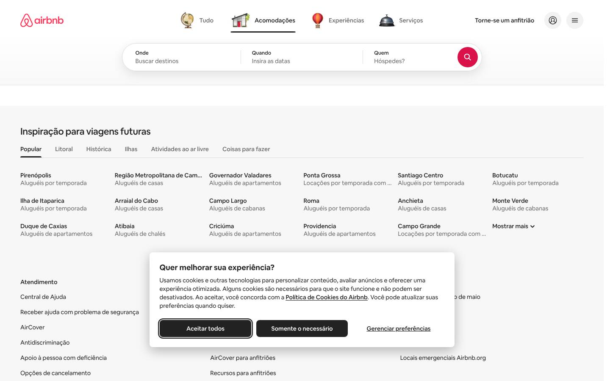

- **Linha do topo com 96 px de altura**: logo à esquerda, **quatro abas no centro** (Tudo, Acomodações, Experiências, Serviços), "Torne-se um anfitrião", avatar e menu (botões redondos de 40 px, fundo `#F2F2F2`).
- **Ícones 3D animados**: cada aba tem um ícone ilustrado (globo, casinha, balão, sino). Ao selecionar, toca um **vídeo WebM curto** (`search-bar-icons/webm/house-selected.webm`) e a aba ganha sublinhado preto de 2 px. É vídeo e não Lottie: leve e com qualidade de 3D renderizado.
- **Header que encolhe ao rolar**: a barra grande vira uma **pílula compacta** de cerca de 430×48 px ("Qualquer lugar | Qualquer dia | Hóspedes?") com ícone e lupa vermelha. Ao clicar, ela se expande de novo com animação. Isso libera cerca de 100 px de tela.

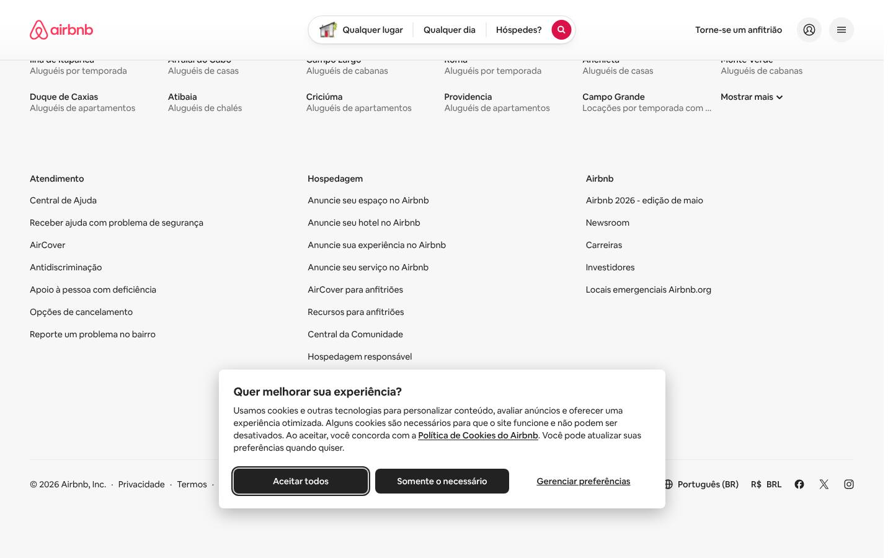

### 3.2 Barra de busca segmentada

- Pílula de **~850×66 px** com borda fina e sombra suave. São três segmentos com rótulo em cima (12 px, peso 500) e valor embaixo (14 px, cinza).
- **Segmento ativo**: vira uma pílula **branca e elevada**, enquanto o resto da barra fica **cinza claro**. Isso mostra com clareza onde a pessoa está.
- **Botão de busca**: círculo vermelho de 48 px que **cresce para uma pílula "Buscar"** com texto quando algum campo está ativo.
- Cada campo preenchido ganha um **"×" para limpar**.

**Onde (destino)**

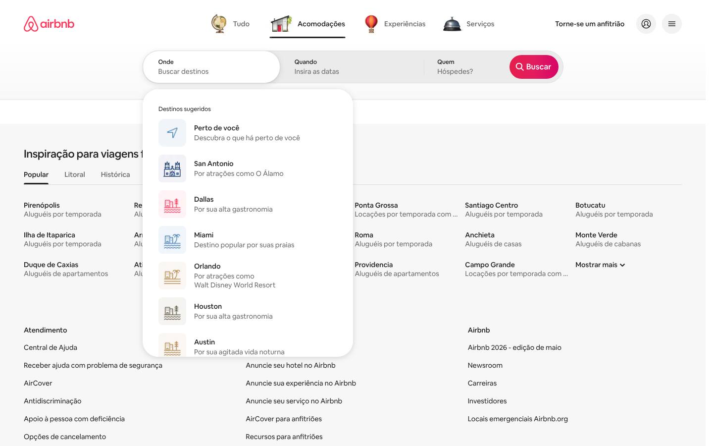

- Painel flutuante com cantos bem arredondados (~32 px). "Destinos sugeridos" com **ícones ilustrados** (prédios, praia), **"Perto de você"** com seta de localização e um **motivo** em cada sugestão ("Por sua alta gastronomia", "Destino popular por suas praias").

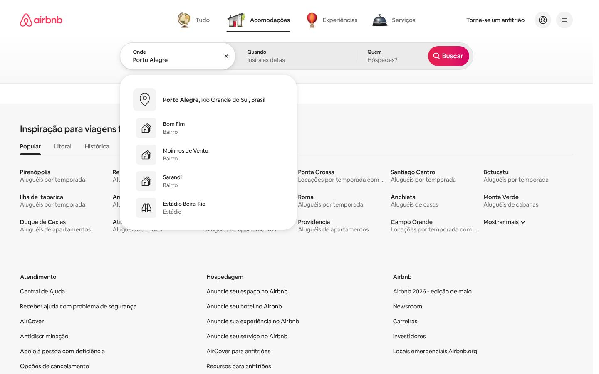

- Autocomplete com o **trecho digitado em negrito** e **tipo do resultado** (Bairro, Estádio) com ícone próprio. Ao escolher, o foco **pula sozinho** para "Quando".

**Quando (datas)**

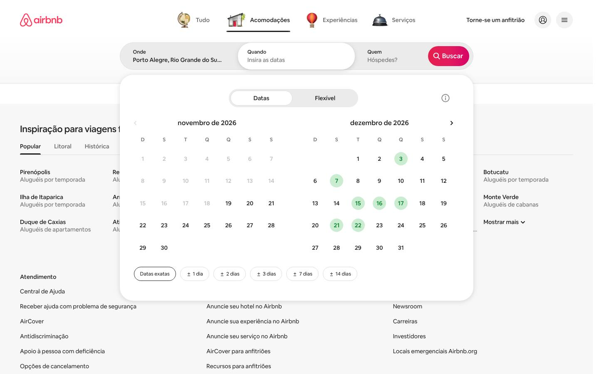

- **Dois meses lado a lado** e alternador segmentado **Datas | Flexível**.
- Atalhos de flexibilidade: chips **"Datas exatas · ±1 dia · ±2 · ±3 · ±7 · ±14 dias"**.
- Dias passados em cinza claro. Alguns dias aparecem em **círculo verde** (destaque de datas).

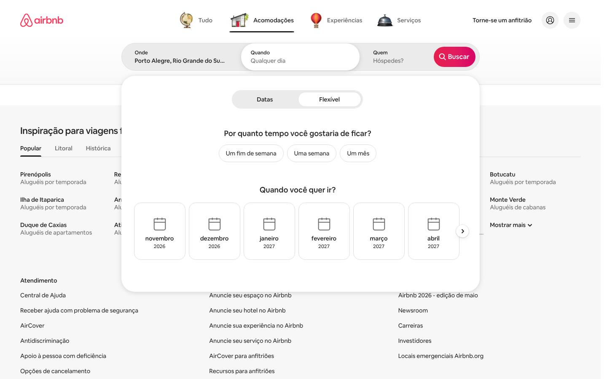

- "Flexível": "Por quanto tempo?" (fim de semana, semana, mês) e um **carrossel de cards de mês** com ícone de calendário.

**Quem (hóspedes)**

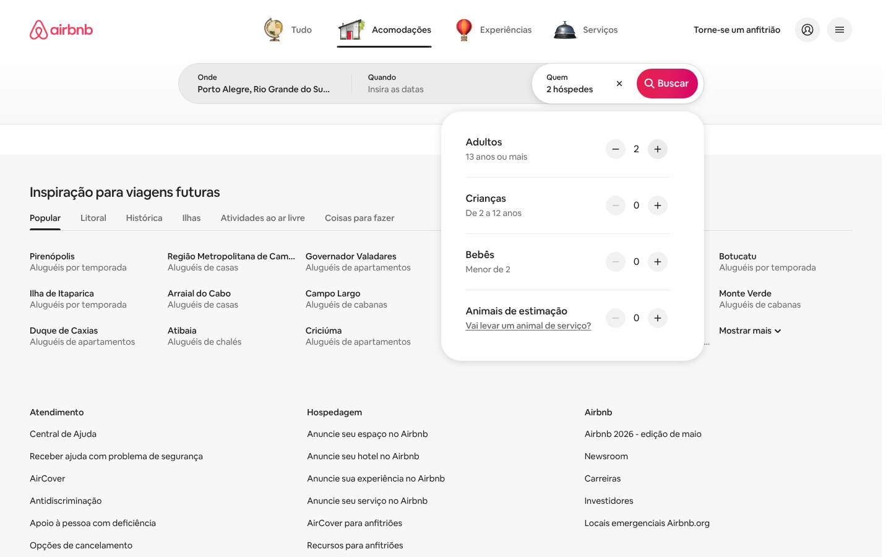

- **Steppers** (– 2 +) com botões redondos de ~32 px. O "–" fica **desabilitado** (mais claro) no mínimo. Cada linha tem rótulo e explicação ("13 anos ou mais"), e há um link contextual ("Vai levar um animal de serviço?").

### 3.3 Conteúdo da home

- No mobile a home é feita de **carrosséis horizontais por cidade e intenção** ("Acomodações ideais para famílias · São Paulo", "Disponível em Broken Bow neste fim de semana") com seta circular para ver mais. No desktop headless esses carrosséis não carregaram (conteúdo personalizado), mas o padrão é o mesmo.
- Bloco **"Inspiração para viagens futuras"** com abas (Popular, Litoral, Histórica, Ilhas...) e uma grade de 6 colunas de links de SEO ("Pirenópolis · Aluguéis por temporada").
- **Rodapé** em 3 colunas (Atendimento, Hospedagem, Airbnb) e barra inferior com idioma, moeda e redes sociais.
- Banner de cookies centralizado, com três botões claros.

### 3.4 Resultados com mapa

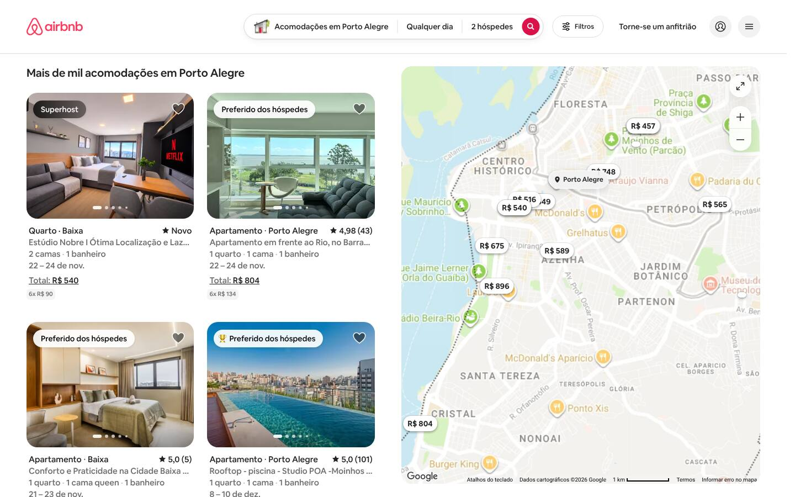

- **Layout**: lista à esquerda com **2 colunas de cards de 307 px** e **mapa à direita com 658 px (~46%)**, cantos arredondados, **fixo (sticky)** enquanto a lista rola. O mapa para no fim da lista, antes do rodapé.
- **H1 objetivo**: "Mais de mil acomodações em Porto Alegre".
- **Header de resultados**: a pílula compacta mostra a busca atual ("Acomodações em Porto Alegre | Qualquer dia | 2 hóspedes") e, ao lado, o botão **"Filtros"** (pílula de 93×40, borda `#DDD`, raio 40 px) com contador de filtros ativos.

**Anatomia do card** (307×377 px, raio 20 px)
1. Foto com proporção de **~4:3** (307×230), carrossel com **pontinhos** e **setas que só aparecem no hover**.
2. **Selo** no canto superior esquerdo ("Preferido dos hóspedes", "Superhost"), em pílula translúcida.
3. **Coração** de 32 px no canto superior direito (transição `transform .25s`).
4. Linha 1: **"Apartamento · Porto Alegre"** (15 px, peso 500, `#222`) e **★ 4,98 (43)** à direita.
5. Linha 2: nome do anúncio em cinza `#6C6C6C`, cortado com reticências.
6. Linha 3: "1 quarto · 1 cama · 1 banheiro".
7. Linha 4: datas.
8. **"Total: R$ 804"** sublinhado (abre o detalhamento). Com desconto aparece **~~R$ 567~~ R$ 457**.
9. **Chips cinza pequenos**: "6x R$ 134", "Cancelamento gratuito".

**Sincronia lista ↔ mapa**

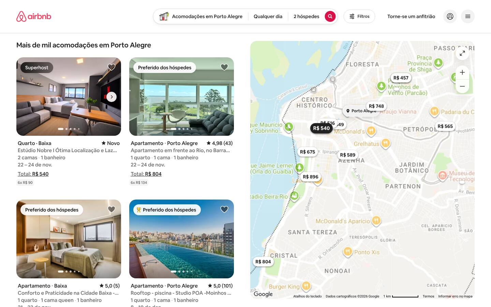

- Passar o mouse no card faz o **pino ficar preto, com texto branco e um pouco maior** (`transform .2s cubic-bezier(.2,0,0,1)`). O pino também sobe para a frente dos outros.

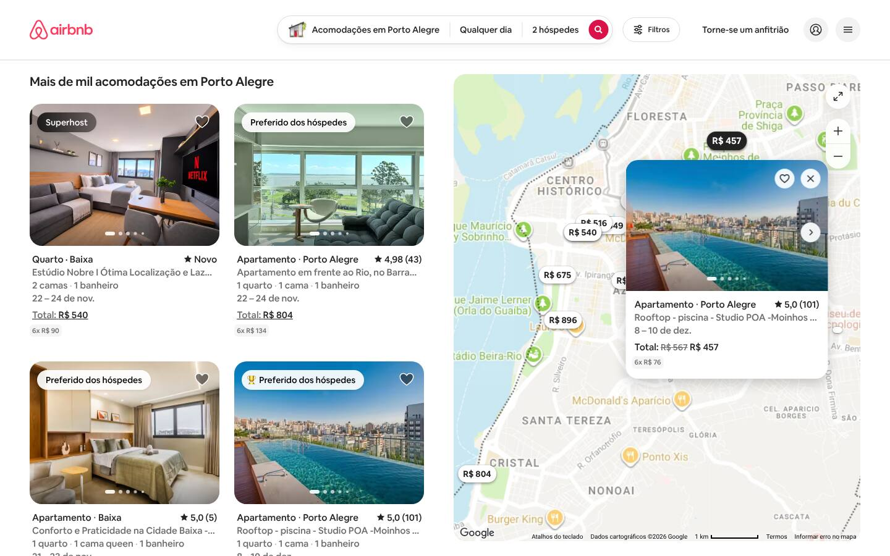

- Clicar no pino abre um **mini-card flutuante** (~330 px) com carrossel de fotos, coração, botão fechar, nota, datas e preço. O pino clicado fica preto.
- **Pinos**: pílulas brancas de ~28 px de altura com o preço em negrito e sombra suave. **Só os 20 imóveis da página atual** aparecem no mapa, então não há cluster nem bolinha anônima.
- Controles do mapa: tela cheia (canto superior direito), zoom + e –, base Google Maps com pontos de interesse (restaurantes, parques, estádio).
- A busca se refaz **sozinha** quando o mapa é arrastado ou recebe zoom.

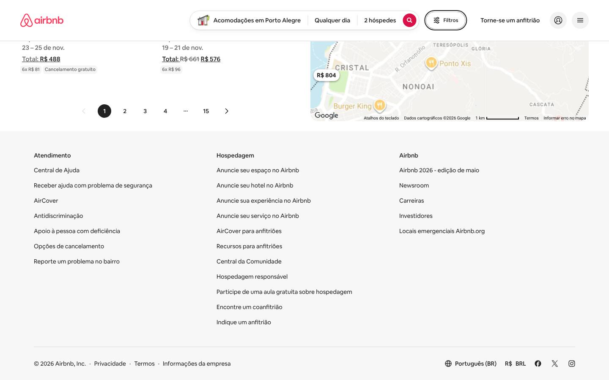

- **Paginação numerada** (1 2 3 4 … 15) com setas, cerca de 18 a 20 por página. Não usa rolagem infinita: a página tem fim, o rodapé é alcançável e o mapa sempre corresponde à lista.

### 3.5 Filtros (modal)

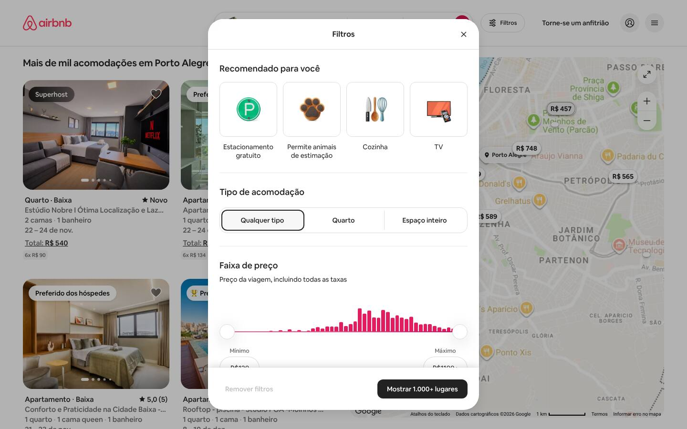
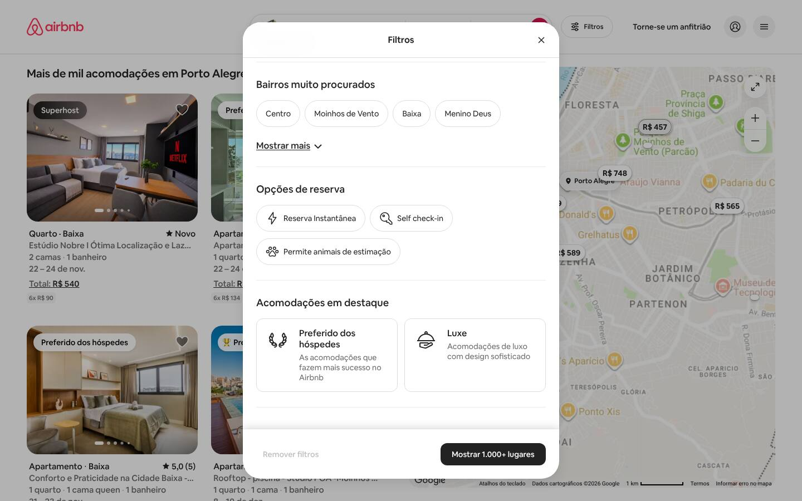

Modal de ~568 px centralizado, cantos grandes, título centralizado e "×" à direita. A ordem das seções:
1. **Recomendado para você**: 4 blocos grandes com ícone 3D (Estacionamento gratuito, Permite animais, Cozinha, TV). Mudam conforme a cidade.
2. **Tipo de acomodação**: controle segmentado (Qualquer tipo | Quarto | Espaço inteiro), com o selecionado em borda preta de 2 px.
3. **Faixa de preço**: "Preço da viagem, incluindo todas as taxas", **histograma em barras** da distribuição de preços, **slider de duas alças** e campos Mínimo e Máximo editáveis.
4. **Quartos e camas**: steppers (Quartos, Camas, Banheiros) começando em "Qualquer".
5. **Comodidades**: chips (Ar-condicionado, Wi-Fi, Máquina de lavar, Piscina...) e "Mostrar mais".
6. **Bairros muito procurados**: chips (Centro, Moinhos de Vento, Cidade Baixa, Menino Deus).
7. **Opções de reserva**: chips com ícone (Reserva Instantânea, Self check-in, Permite animais).
8. **Acomodações em destaque**: 2 cards (Preferido dos hóspedes, Luxe).
9. **Tipo de propriedade, Acessibilidade, Idioma do anfitrião**: acordeões fechados.
10. **Rodapé fixo**: "Remover filtros" (cinza e desabilitado até alguém mudar algo) e botão escuro **"Mostrar 1.000+ lugares"**, que **atualiza a contagem ao vivo** a cada ajuste.

### 3.6 Página do anúncio

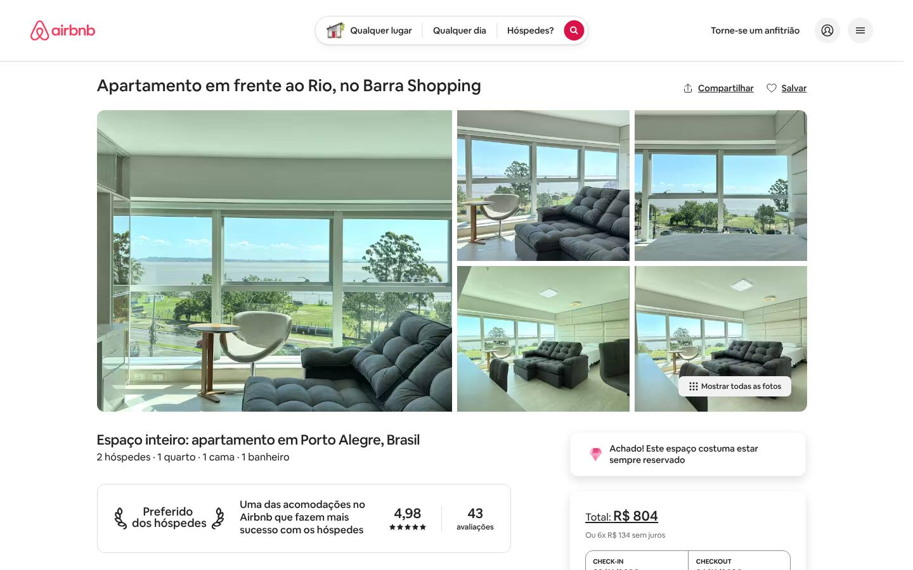

- **Título** (~26 px) com **Compartilhar** e **Salvar** sublinhados à direita.
- **Mosaico 1 + 4**: foto principal de 560×476 e 4 menores. Espaço de 8 px entre elas e cantos arredondados **só nas bordas externas** do bloco. Botão **"Mostrar todas as fotos"** (fundo `#F2F2F2`, raio 8 px, 12 px).
- Conteúdo em **duas colunas**: texto com ~650 px e **card de reserva fixo com 372 px**.

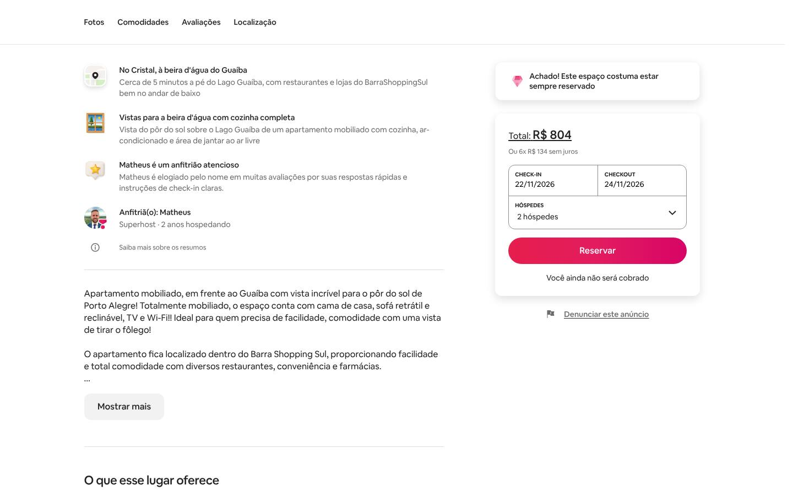

- Depois da galeria, a header **vira uma barra de âncoras** (Fotos, Comodidades, Avaliações, Localização) com 80 px.
- **Card de reserva**: "Total: R$ 804" sublinhado, "Ou 6x R$ 134 sem juros", grupo de campos com cantos de 8 px (CHECK-IN | CHECKOUT | HÓSPEDES), botão **"Reservar"** de 324×48 em pílula com **gradiente** `linear-gradient(to right, #E61E4D 0%, #E31C5F 50%, #D70466 100%)`, e a frase **"Você ainda não será cobrado"**, que reduz o medo do clique.
- Acima do card, um aviso de escassez: **"Achado! Este espaço costuma estar sempre reservado"** com ícone de diamante.

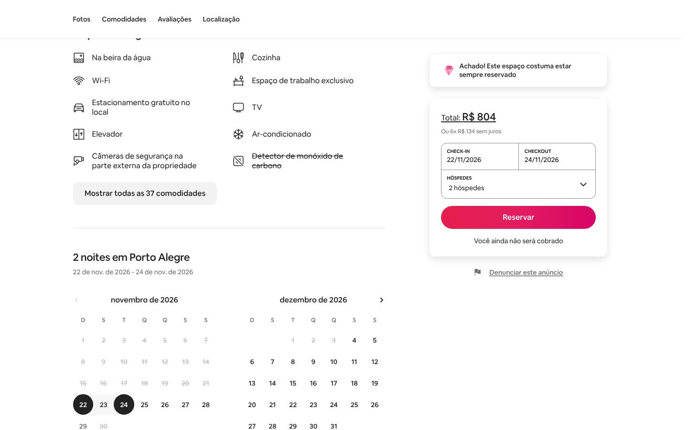

- **Destaques** com ícones 3D ("No Cristal, à beira d'água do Guaíba", "Matheus é um anfitrião atencioso") e o aviso "Saiba mais sobre os resumos" (são resumos de avaliações).
- Descrição cortada com botão **"Mostrar mais"** que abre um modal.
- **Comodidades**: 10 com ícone de linha, as que **faltam aparecem riscadas** ("Detector de monóxido de carbono") e botão "Mostrar todas as 37 comodidades".
- **Calendário de disponibilidade embutido** (dois meses), com dias indisponíveis riscados.

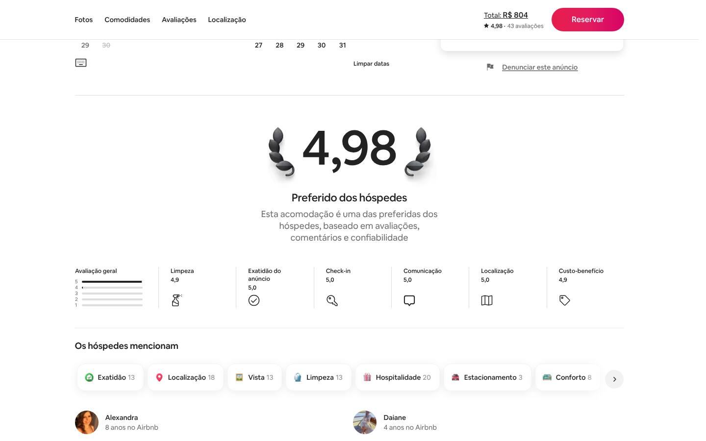

- Quando o card de reserva sai da tela, a barra de âncoras **ganha o preço, a nota e o botão "Reservar"** à direita.
- **Avaliações**: nota gigante (4,98) entre **louros**, explicação do selo, notas por categoria com ícone (Limpeza, Exatidão, Check-in, Comunicação, Localização, Custo-benefício), distribuição de 1 a 5 em barras, carrossel **"Os hóspedes mencionam"** com chips e contagem ("Localização 18"), e cards de avaliação com foto e tempo de Airbnb.

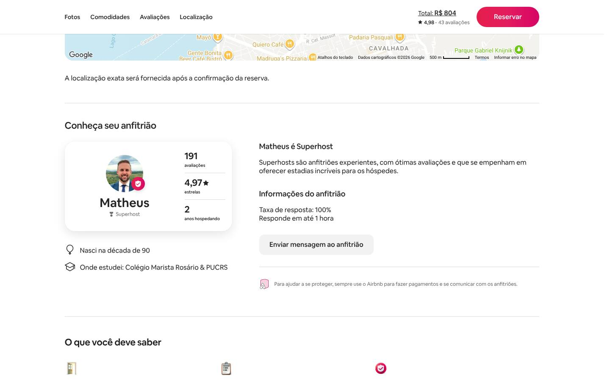

- **Mapa "Onde você estará"** com o aviso "A localização exata será fornecida após a confirmação".
- **Card do anfitrião** com foto, selo, número de avaliações, nota e anos hospedando, mais taxa de resposta, tempo de resposta e botão "Enviar mensagem".
- **"O que você deve saber"**: regras, segurança e cancelamento.
- Ordem real das seções (atributo `data-section-id`, o que indica interface montada pelo servidor): `TITLE → HERO → NAV → BOOK_IT_NAV → OVERVIEW → GUEST_FAVORITE_BANNER → HIGHLIGHTS → DESCRIPTION → AMENITIES → AVAILABILITY_CALENDAR → BOOK_IT_SIDEBAR → REPORT → REVIEWS → LOCATION → MEET_YOUR_HOST → HOST_LEGAL → POLICIES → SEO_LINKS`.

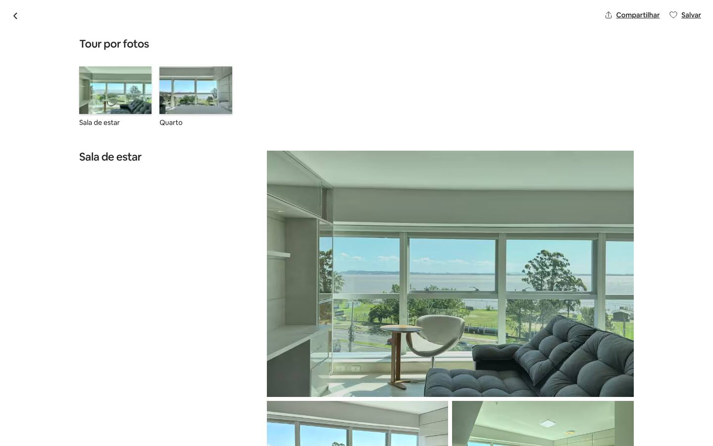

- **"Tour por fotos"**: página própria com miniaturas por **cômodo** (Sala de estar, Quarto) e as fotos agrupadas por cômodo, com o nome à esquerda.

### 3.7 Login

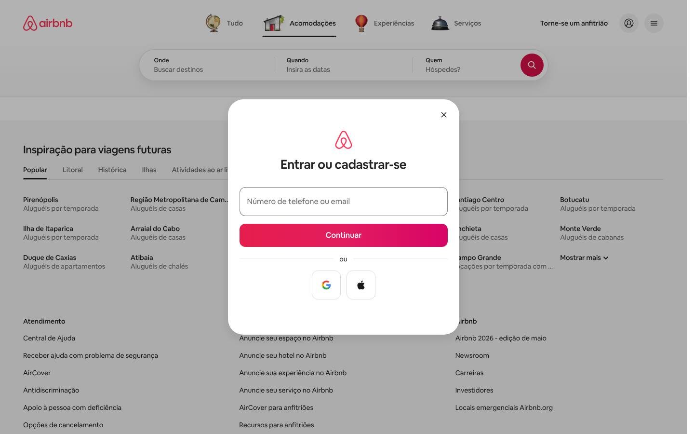

- Modal com **um campo só** ("Número de telefone ou email"), botão "Continuar" com o mesmo gradiente, separador "ou" e botões quadrados Google e Apple. Nada de senha na primeira tela.

---

## 4. Airbnb no mobile, ponta a ponta

| Home | Home rolando | Busca em tela cheia |
|---|---|---|
| 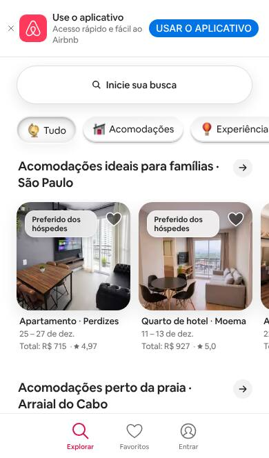 | 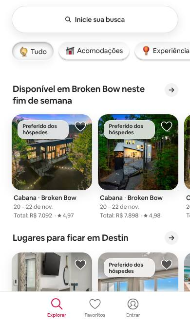 | 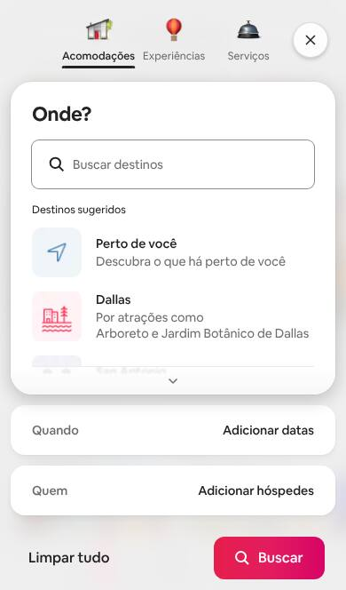 |

- **Home**: pílula grande **"Inicie sua busca"** (~340×56, sombra), que fica fixa no topo ao rolar. Abaixo, **chips de categoria** com ícone 3D (Tudo, Acomodações, Experiências) em rolagem horizontal, e carrosséis de cards (~165 px de largura) com título, datas, "Total" e nota.
- **Barra de abas fixa no rodapé** com 3 itens (Explorar, Favoritos, Entrar), ícone e texto, e o item ativo na cor da marca.
- **Busca**: abre em **tela cheia** com cards empilhados em acordeão. "Onde?" vem aberto (campo e sugestões); "Quando" e "Quem" ficam fechados mostrando "Adicionar datas" e "Adicionar hóspedes". O fundo fica desfocado. No rodapé, "Limpar tudo" e o botão **"Buscar"** com gradiente. Botão "×" redondo no topo.

| Resultados (mapa + sheet) | Sheet puxada | Botão "Mapa" flutuante |
|---|---|---|
| 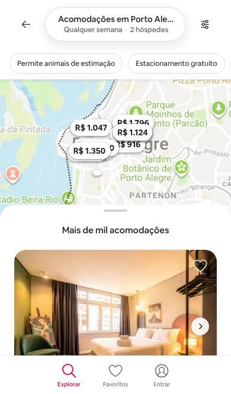 | 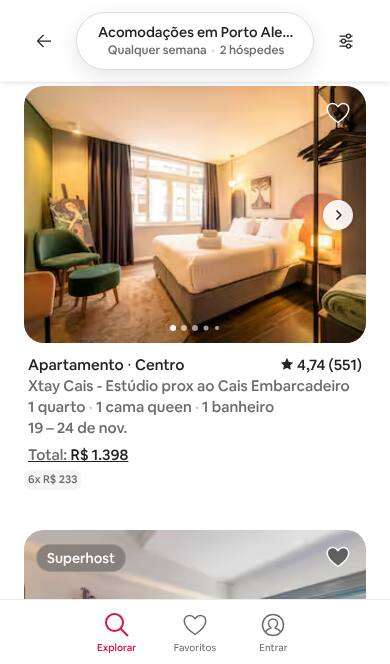 | 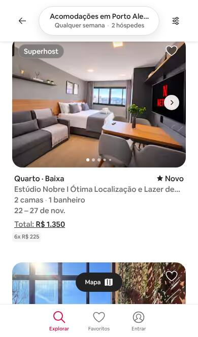 |

- **Resultados**: header em pílula (voltar, "Acomodações em Porto Alegre" com "Qualquer semana • 2 hóspedes" embaixo, ícone de filtros), **chips de filtro rápido** em rolagem horizontal (Permite animais, Estacionamento gratuito, Reserva Instantânea, Academia...), **mapa ocupando ~45%** e um **bottom sheet com alça** ("Mais de mil acomodações") que sobe por cima do mapa.
- Com a sheet aberta, a lista vira **cards de largura total** (342 px) e aparece um **botão escuro flutuante "Mapa"** para voltar ao mapa.
- O mapa tem o rótulo de acessibilidade "Google Maps. Mostrando 20 acomodações".

| Filtros (sheet) | Anúncio | Anúncio rolando |
|---|---|---|
| 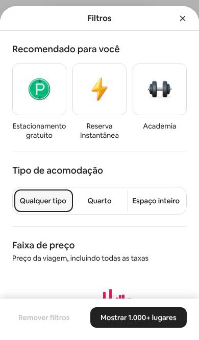 | 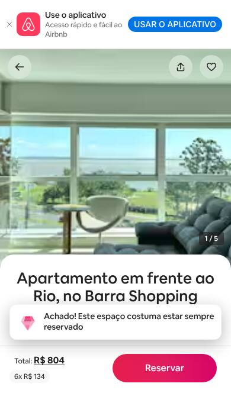 | 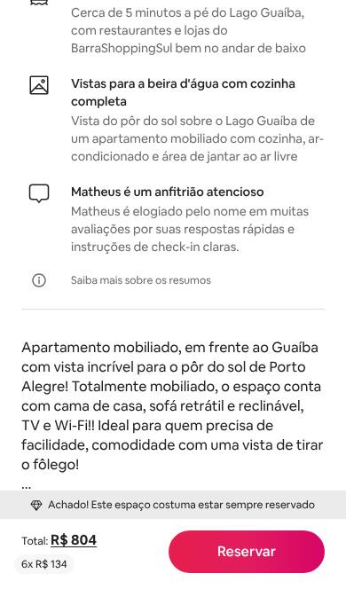 |

- **Filtros**: sheet de altura quase total, com as mesmas seções do desktop e o rodapé fixo ("Remover filtros" e "Mostrar 1.000+ lugares").
- **Anúncio**: carrossel de fotos de **largura total** com contador "1 / 5", **botões flutuantes redondos** (voltar, compartilhar, salvar) e o conteúdo numa **folha com cantos arredondados que sobe por cima da foto**. Título centralizado (28 px). **Barra fixa no rodapé** com "Total: R$ 804", "6x R$ 134" e o botão "Reservar". O aviso "Achado!" vira uma faixa logo acima dessa barra.
- Ponto negativo: banners e sheets **"Use o aplicativo"** que atrapalham. Isso **não deve ser copiado**.

---

## 5. Fundamentos técnicos do Airbnb (o "código")

### 5.1 Tipografia
- Fonte **Airbnb Cereal VF** (variável, **um arquivo de 68 KB** para todos os pesos). A pilha de fontes cai para `Circular, -apple-system, BlinkMacSystemFont, Roboto, Helvetica Neue`. A Cereal é proprietária: na Uhome, use uma variável equivalente (Inter, Manrope, Plus Jakarta Sans ou a fonte da marca).
- Corpo de **14 px**, cor `#222222`. Texto secundário `#6C6C6C`.
- Título do card: 15 px / 500 / 19 px. H2 de seção: **22 px / 500 / 26 px com letter-spacing −0,44 px**. Título do anúncio: ~26 px. Nota grande: ~88 px.
- Hierarquia feita com **peso 500 e cor**, não com tamanhos exagerados.

### 5.2 Cores
- Texto `#222`, secundário `#6C6C6C`, bordas `#DDDDDD`, fundos de botão secundário `#F2F2F2` e de seção `#F7F7F7`.
- Marca `#FF385C`. Gradiente de ação: `#E61E4D → #E31C5F → #D70466`.
- Um único acento de cor (a marca) e **todo o resto em preto, branco e cinza**. É isso que faz as fotos se destacarem.

### 5.3 Tokens medidos (647 variáveis CSS)
```css
/* Raios */
--corner-radius-tiny: 4px;   --corner-radius-small: 8px;  --corner-radius-medium: 12px;
--corner-radius-large: 16px; --corner-radius-xlarge: 20px; --corner-radius-xxlarge: 24px;
--corner-radius-xxxlarge: 32px;

/* Elevação */
--elevation-tertiary:  0 2px 4px rgba(0,0,0,.18);
--elevation-secondary: 0 6px 16px rgba(0,0,0,.12);   /* card de reserva, popovers */
--elevation-primary:   0 6px 20px rgba(0,0,0,.20);
--elevation-high:      0 8px 28px rgba(0,0,0,.28);   /* modais */

/* "Materiais" (vidro) */
--material-regular: rgba(250,250,250,.72) + backdrop-filter: blur(24px) saturate(1.6);
--material-thick:   rgba(240,240,240,.86) + backdrop-filter: blur(12px) saturate(3);

/* Molas (springs) em CSS puro com linear() */
--motion-springs-snappy:   294ms;  /* toques, toggles */
--motion-springs-fast:     452ms;
--motion-springs-standard: 584ms;  /* abrir painéis */
--motion-springs-slow:     746ms;
--motion-springs-medium-bounce: 574ms; /* com leve "quique" acima de 1.0 */
/* exemplo: linear(0, 0.186, 0.465, 0.682, 0.822, 0.905, 0.951, 0.976, 0.990, 0.996, 1) */
```
- **Curva padrão de microinteração**: `cubic-bezier(0.2, 0, 0, 1)`, com `box-shadow .2s` e `transform .25s`. Uma transição de `transform` de 100 ms fica reservada para o efeito de pressionar.
- Anel de foco duplo nos botões: `0 0 0 2px rgba(255,255,255,.8), 0 0 0 4px #222`.

### 5.4 Arquitetura percebida
- **Interface montada pelo servidor** (seções com `data-section-id`): a página do anúncio é uma lista de blocos que o backend ordena e liga ou desliga.
- **Imagens** num CDN (`a0.muscache.com`) com redimensionamento pela URL.
- **Mapa** Google Maps JS com estilo próprio e pinos em HTML (pílulas são `div`s, não camada de canvas). Por isso dá para animar hover e seleção com CSS.
- **Acessibilidade exemplar**: "Pular para o conteúdo", "4,98 de uma avaliação média de 5, 43 avaliações", "Foto 1 de 6", "Filtros aplicados no momento: Qualquer dia, 2 hóspedes. Alterar busca.", "O preço original era R$ 567 e o novo preço total é R$ 457", "Reduzir o número de Adultos".

### 5.5 Performance real

| Métrica | Airbnb desktop | Airbnb mobile |
|---|---|---|
| PageSpeed laboratório: FCP | 687 ms | 2,4 s |
| PageSpeed laboratório: LCP | 2,8 s | **15,8 s** |
| PageSpeed laboratório: TBT | 754 ms | **1,6 s** |
| PageSpeed laboratório: CLS | 0,000 | 0,000 |
| PageSpeed campo (usuários reais) | FCP, LCP e CLS rápidos; INP médio | FCP e CLS rápidos; LCP e INP médios |
| Medição própria (home, headless) | TTFB 688 ms, LCP 1,4 s, CLS 0,0004 | LCP 2,4 s, CLS 0,052 |
| Medição própria (anúncio) | TTFB 561 ms, LCP 1,1 s, CLS 0,006 | LCP 0,65 s, CLS 0,006 |
| JavaScript da home | **122 arquivos, ~3,8 MB**, mais 443 KB de CSS | — |

**Leitura:** o Airbnb **não é leve**. Ele **parece** rápido por causa de CLS zero (nada pula), skeletons, pré-carregamento entre páginas e interface otimista. A Uhome pode ter os dois: a leveza que já tem e a percepção de velocidade do Airbnb.

---

## 6. uhome.com.br hoje: o que dá para afirmar

### 6.1 Estrutura (páginas indexadas, Ubersuggest Brasil)
| URL | Título atual | Observação |
|---|---|---|
| `/` | Uhome Imóveis: Imóveis à Venda em Porto Alegre | ~121 visitas orgânicas por mês (estimativa) e 15 domínios apontando |
| `/venda` | Imóveis à Venda em Porto Alegre | Sem o sufixo da marca |
| `/busca` | **à venda em Porto Alegre - Uhome Imóveis** | **Falta o tipo do imóvel no começo** |
| `/imovel/{tipo}-{quartos}-{bairro}-{codigo}` | Apartamento 2 quartos — Centro Histórico \| R$ 330.000 | Bom padrão (tipo, bairro, preço) |
| `/imovel/casa-condominio-3-quartos-hipica-71307504-CL` | **Casa_condominio 3 quartos — Hípica** \| R$ 447.000 | **Valor cru do banco no título** |
| `/imovel/terreno-para-venda-vila-nova-...` | Terreno para Venda — Vila Nova \| R$ 206.000 - Uhome Imóveis | Sufixo da marca às vezes sim, às vezes não |
| `/blog/como-negociar-preco-imovel` | Como negociar o preço de um imóvel: 8 técnicas que funcionam | Conteúdo de topo de funil já existe |
| `/c/{corretor}/imovel/{slug}` | — | Link com atribuição de corretor (código do CRM) |
| `/vitrine/{id}` | — | Vitrine pública montada no CRM |

As URLs indexadas aparecem como `http://` e o PageSpeed acusa **redirecionamentos** (161 ms no desktop e 601 ms no mobile). Vale garantir que canonical, sitemap e links internos usem sempre `https://uhome.com.br/...` direto.

### 6.2 Recursos existentes (contrato de eventos que o site envia ao CRM, `src/lib/siteJornada.ts`)
`pagina_vista`, `busca_feita`, **`categoria_tocada`** (o site tem categorias, como o Airbnb), `filtro_aplicado`, `imovel_visto`, `foto_aberta` (galeria), `favorito_salvo`, **`dia_escolhido` e `visita_pedida`** (agendamento), `informacoes_pedidas` (formulário), **`lia_aberta` e `lia_lead`** (assistente com IA), `whatsapp_tocado`, **`simulacao_feita`** (financiamento), `pedido_corretor` e `rolagem_50`.

Em recursos de conversão, a Uhome **já tem mais que o Airbnb** para o próprio negócio. O gap está na **forma**: como esses recursos aparecem, em que ordem e com que acabamento.

### 6.3 Card de imóvel (espelho em `SitePropertyCard.tsx`, "mirrors the SearchPropertyCard from uhome.com.br")
- Foto **4:3**, `rounded-2xl` (16 px), skeleton com pulso enquanto carrega e fade de opacidade de 500 ms.
- **Zoom de 1,04 na foto** no hover e **até 8 fotos carregadas só no hover** (economiza banda).
- Setas brancas redondas de 32 px **no hover**, pontinhos (o ativo vira uma barra de 18 px).
- Selos: **"Anúncio novo"** (até 7 dias) em branco, **"Exclusivo"** (destaque) em preto 80%.
- Coração vermelho `#ff385c` quando favoritado (é a mesma cor do Airbnb: **trocar pela cor da marca Uhome**).
- Título "Apartamento 2 quartos — Bairro" e linha "84 m² · 2 quartos · 1 vaga". Entrada com fade e deslocamento de 8 px, escalonada a cada 30 ms.

**Comparado ao Airbnb**: o card está **muito próximo**. Faltam a linha de preço com hierarquia (preço + condomínio + IPTU), **chips de informação** (parcela estimada, "Aceita financiamento", "Pronto para morar"), **prova social** (vistas, "12 pessoas salvaram"), setas também no toque do celular e o **sublinhado do preço abrindo o detalhamento**.

### 6.4 Mapa (espelho em `SearchMapBox.tsx`, "Mirrors the SearchMap from uhome.com.br")
- **Mapbox GL, estilo `streets-v12`**, controle de zoom sem bússola.
- **Clusters** de raio 64 até o zoom 15: círculos **roxos `#5B6CF9`** com borda branca e número.
- Pinos individuais são **círculos brancos em camada de canvas** e o **preço só aparece a partir do zoom 14**. O selecionado fica `#222` (preto).
- Barra inferior com **"Desenhar área"**, **"Perto de você"** e **"Buscar ao mover"** (desligado por padrão). Quando o mapa é movido, aparece o botão **"Buscar nessa região"**.
- Popup em React com prévia do imóvel.

**Comparado ao Airbnb**
| Ponto | Airbnb | Uhome | Ação |
|---|---|---|---|
| Preço no pino | Sempre, para os itens da página | Só a partir do zoom 14 | Mostrar pílulas com preço para os itens visíveis da página (HTML), e clusters só quando houver mais de ~60 no recorte |
| Forma do pino | Pílula (preço inteiro legível) | Círculo de canvas | Pílula HTML com estados normal, hover, selecionado e visto |
| Cor do cluster | Não usa cluster | `#5B6CF9` (fora da paleta) | Usar a cor da marca ou `#222` |
| Busca ao mover | Automática | Opcional e desligada | Ligar por padrão (debounce de 400 ms) e manter o toggle |
| Hover card → pino | Pino inverte e cresce | Existe destaque (confirmar animação) | Animar com `transform .2s cubic-bezier(.2,0,0,1)` |
| Desenhar área | Não tem | **Tem** | Manter: é um diferencial |
| Pontos de interesse | Restaurantes, parques, estádio | Padrão `streets-v12` | Destacar escolas, mercados, parques, transporte (ouro em imobiliária) |

### 6.5 Performance (PageSpeed de hoje)

| Métrica | Uhome desktop | Airbnb desktop | Uhome mobile | Airbnb mobile |
|---|---|---|---|---|
| FCP | **362 ms** | 687 ms | **1,4 s** | 2,4 s |
| LCP | **1,6 s** | 2,8 s | **5,6 s** | 15,8 s |
| TBT | **12 ms** | 754 ms | **84 ms** | 1,6 s |
| Speed Index | 3,8 s | 3,1 s | 6,8 s | 8,5 s |
| TTI | 2,2 s | 4,2 s | 8,5 s | 23,8 s |
| CLS | 0,024 | 0,000 | **0,100** | 0,000 |
| Campo (usuários reais) | Tudo rápido | INP médio | **FCP e LCP médios** | LCP e INP médios |
| JS não usado | 269 KB | 1.142 KB | 269 KB | 1.031 KB |

**Leitura:** a Uhome vence em leveza. Os pontos a atacar são **LCP mobile 5,6 s** (meta: menos de 2,5 s), **CLS mobile 0,100** (meta: menos de 0,05, idealmente zero como o Airbnb), **Speed Index** (a página "monta" devagar) e os **601 ms de redirecionamento**.

### 6.6 Bloqueio de robôs
- Navegador automatizado e leitores de página recebem **403 do Cloudflare**. O Google (PageSpeed) passou normalmente.
- Se o "Bot Fight Mode" ou o bloqueio de robôs de IA estiver ligado, **ChatGPT, Claude, Perplexity e Gemini podem não conseguir ler os imóveis** e não vão citar a Uhome quando alguém perguntar "imóveis à venda no Moinhos de Vento". Decidir de forma consciente: liberar os robôs de busca e IA nas páginas `/imovel`, `/venda`, `/blog` e manter o bloqueio só onde houver abuso.

### 6.7 Versão antiga
O snapshot público de 16/03/2026 (Internet Archive) era um **Next.js** de template de imobiliária (`/property-list/[contract]/[...filters]`). O site atual, ligado ao banco Supabase com a tabela `imoveis`, substituiu esse modelo.

---

## 7. Comparativo lado a lado (o que reproduzir, adaptado)

### 7.1 Tradução Airbnb → imobiliária
| Airbnb | Uhome (compra de imóvel) |
|---|---|
| Onde | **Onde**: bairro, empreendimento, rua ou **código do imóvel**, com tipo de resultado (Bairro, Empreendimento, Código) |
| Quando | **Tipo**: apartamento, casa, cobertura, terreno, comercial, em chips com ícone |
| Quem | **Quartos e preço**: steppers de quartos e vagas, e faixa de preço com histograma |
| Datas flexíveis (±dias) | **Faixa flexível de preço** (±10%, ±20%) e "Aceito imóvel na planta" |
| Total da viagem | **Preço + condomínio + IPTU** e **parcela estimada** ("ou R$ 3.840/mês*") |
| Reservar | **Agendar visita** (CTA principal) e **WhatsApp** (secundário) |
| "Você ainda não será cobrado" | **"Sem compromisso · Corretor responde em até 15 min"** |
| Anfitrião | **Corretor responsável** (foto, CRECI, vendas, nota, tempo de resposta) |
| Avaliações | Depoimentos de compradores, nota no Google, "Vendido pela Uhome" |
| "Achado! Costuma estar reservado" | "Muito procurado: 23 pessoas viram esta semana", "Preço abaixo da média do bairro" |
| Comodidades riscadas | Itens do condomínio (piscina, portaria 24 h...), com os que faltam riscados |
| Calendário de disponibilidade | **Escolher dia e horário da visita** embutido na página |
| Tour por fotos por cômodo | Tour por cômodo e **planta baixa**, vídeo e tour 360° |
| Experiências / Serviços | **Lançamentos / Prontos / Financiamento** |

### 7.2 Tabela de gaps por área
| Área | Airbnb | Uhome hoje | Gap | Prioridade |
|---|---|---|---|---|
| Header | Abas com ícone 3D, encolhe ao rolar | Confirmar | Header compacta e abas Comprar / Lançamentos / Financiar | P1 |
| Busca desktop | Pílula segmentada com painéis | Confirmar | Construir a pílula segmentada | P0 |
| Busca mobile | Tela cheia em acordeão | Confirmar | Construir | P0 |
| Autocomplete | Negrito no trecho e tipo do resultado | Confirmar | Tipos Bairro, Empreendimento e Código | P1 |
| Categorias | Chips com ícone 3D | Existe (`categoria_tocada`) | Padronizar ícones e animação | P2 |
| Lista + mapa | 2 colunas + mapa fixo 46% | Existe | Ajustar proporção e mapa fixo | P1 |
| Pinos | Pílula com preço, sempre | Círculo, preço só no zoom ≥14 | Refazer pinos | **P0** |
| Busca ao mover | Automática | Desligada por padrão | Ligar | **P0** |
| Mini-card do pino | Carrossel, coração, fechar | Popup React | Igualar acabamento | P1 |
| Filtros | Modal, histograma, contagem ao vivo | Confirmar | Construir | P0 |
| Chips de filtro rápido (mobile) | Sim | Confirmar | Construir | P1 |
| Bottom sheet mobile | Alça e pontos de parada | Confirmar | Construir | P0 |
| Card | Selos, nota, total, chips | Muito próximo | Preço completo, chips, prova social | P1 |
| Paginação | Numerada, mapa = página | Confirmar | Escolher paginação ou "carregar mais" com mapa coerente | P2 |
| Página do imóvel: galeria | Mosaico 1+4 e tour | Galeria existe | Mosaico e tour por cômodo | P0 |
| Página do imóvel: CTA | Card fixo, CTA no topo, barra no rodapé | Confirmar | Construir | **P0** |
| Página do imóvel: confiança | Avaliações, anfitrião, regras | Confirmar | Corretor, depoimentos, "O que você deve saber" | P1 |
| Login | Um campo (telefone ou email) | Confirmar | Telefone primeiro, com WhatsApp | P2 |
| Motion | Molas, press-scale, vídeos 3D | Fade e zoom no card | Tokens de movimento | P1 |
| Performance mobile | Percebida excelente | LCP 5,6 s, CLS 0,1 | Orçamento de performance | **P0** |
| SEO técnico | Impecável | Títulos com erro, http, redirecionamentos | Corrigir | **P0** |
| Acessibilidade | Rótulos ricos | Confirmar | Auditoria | P1 |

---

## 8. Plano de reprodução

> Ordem pensada para entregar valor desde a primeira semana. Cada fase tem critério de aceite verificável. As estimativas consideram 1 dev front-end com apoio de design.

### Fase 0: fundação do design system (3 a 5 dias)
- **Tokens** (seção 10.1): raios 4/8/12/16/20/24/32, 4 níveis de elevação, molas `snappy/fast/standard/slow` com `linear()`, curva padrão `cubic-bezier(.2,0,0,1)`, materiais de vidro para headers e sheets.
- **Paleta**: preto `#222`, cinzas `#6C6C6C`, `#DDDDDD`, `#F2F2F2`, `#F7F7F7` e **um único acento: a cor da marca Uhome**. Trocar o vermelho `#ff385c` do coração e o roxo `#5B6CF9` dos clusters.
- **Fonte variável** num arquivo só, com `font-display: swap` e `preload`.
- **Componentes base**: `SegmentedPill`, `Chip`, `Stepper`, `Sheet` (com pontos de parada), `Modal` com rodapé fixo, `PriceHistogramSlider`, `IconTile`, `Badge`, `Skeleton`.
- **Aceite**: página interna `/design` mostrando todos os componentes em claro, escuro e com movimento reduzido.

### Fase 1: SEO e performance (rápido e de alto impacto, 3 a 5 dias)
- Títulos: mapear o tipo do imóvel para rótulo (`casa_condominio` → "Casa em condomínio"), corrigir `/busca` ("Apartamentos à venda em Porto Alegre"), sufixo `| Uhome Imóveis` padronizado.
- Canonical, sitemap e links internos em `https://uhome.com.br` direto, para eliminar os 601 ms de redirecionamento.
- JSON-LD em `/imovel/*`: `RealEstateListing` + `Offer` (preço) + `Place` / `GeoCoordinates` + `BreadcrumbList`. Na home, `RealEstateAgent` com endereço e telefone.
- Imagens: `srcset` com AVIF/WebP, `sizes` corretos, `fetchpriority="high"` na primeira foto do imóvel e no primeiro card, `width` e `height` sempre definidos (zera o CLS).
- Mapa no mobile **carregado sob demanda** (só quando a pessoa abre o mapa ou ele entra na tela). Mapbox GL pesa mais de 200 KB.
- Cloudflare: liberar Googlebot, Bingbot e robôs de IA nas páginas públicas.
- **Aceite**: LCP mobile < 2,5 s, CLS < 0,05 e zero redirecionamento no PageSpeed. Nenhum título com `_`.

### Fase 2: busca (1 a 1,5 semana)
- **Desktop**: pílula segmentada **Onde | Tipo | Quartos e preço**, com segmento ativo branco elevado, resto cinza, botão que vira "Buscar" e "×" por campo.
- **Onde**: sugestões com ícone e motivo ("Moinhos de Vento · Mais procurado por famílias"), "Perto de você", autocomplete com trecho em negrito e tipo do resultado, além de busca por código ("Código 23028").
- **Header compacta ao rolar** (seção 10.3) com transição de 300 a 450 ms.
- **Mobile**: tela cheia em acordeão com rodapé "Limpar tudo" e "Buscar".
- Estado da busca **sempre na URL** (compartilhável e com voltar funcionando).
- **Aceite**: do primeiro toque ao resultado em **no máximo 3 interações**. Teclado funciona em tudo (Tab, setas, Enter, Esc).

### Fase 3: resultados e mapa (1,5 a 2 semanas)
- Layout desktop de **lista com 2 colunas + mapa fixo (~45%)**, cantos de 16 px, mapa parando antes do rodapé.
- **Pinos-pílula HTML com preço compacto** ("R$ 890 mil") para os itens da página. Estados: normal (branco), **hover sincronizado com o card** (preto, escala 1,08), selecionado e visto (cinza). Clusters só quando houver mais de ~60 pinos no recorte (seção 10.4).
- **Busca automática ao mover** (debounce de 400 ms) ligada por padrão, mantendo o toggle e "Desenhar área".
- Mini-card flutuante no clique do pino: carrossel, coração, fechar, preço e chips.
- **Mobile**: mapa em cima com bottom sheet de 3 pontos de parada (fechada com alça, metade, cheia), botão flutuante "Mapa / Lista" e chips de filtro rápido.
- Camada de **pontos de interesse** (escolas, mercados, parques, metrô e ônibus).
- **Aceite**: hover no card acende o pino em menos de 16 ms (um quadro). Arrastar o mapa atualiza a lista sem clique. A sheet arrasta a 60 fps no celular.

### Fase 4: filtros (1 semana)
- Modal no desktop e sheet no mobile, com seções: **Recomendado** (blocos com ícone: Aceita financiamento, Pronto para morar, Com vaga, Pet friendly), **Tipo** (segmentado), **Preço** com histograma real da base, slider duplo e campos, **Quartos, Suítes, Banheiros, Vagas** (steppers), **Área**, **Condomínio**, **Bairros procurados** (chips), **Lazer** (chips), **Situação** (pronto, em obra, na planta) e acordeões para o resto.
- Rodapé fixo com "Limpar" desabilitado até haver mudança e **"Mostrar 312 imóveis" com contagem ao vivo** (consulta de contagem com debounce de 250 ms).
- **Aceite**: cada mudança atualiza a contagem em menos de 500 ms. Fechar e abrir preserva o estado.

### Fase 5: página do imóvel (2 semanas)
- Título, Compartilhar e Salvar, **mosaico 1+4** com cantos só nas bordas externas e "Mostrar todas as fotos".
- **Tour por cômodo** (quando as fotos tiverem categoria) e planta baixa, vídeo e 360°.
- **Duas colunas** com **card de ação fixo** (seção 10.5): preço, condomínio, IPTU, **parcela estimada** com link para a simulação, seleção de **dia e horário da visita**, botão principal **"Agendar visita"**, WhatsApp como secundário e a frase "Sem compromisso".
- Barra de âncoras (Fotos, Detalhes, Condomínio, Localização, Simulação) que **ganha preço e CTA quando o card sai da tela**.
- **Mobile**: carrossel de largura total com contador, botões flutuantes, folha arredondada sobre a foto e **barra fixa no rodapé** (preço e "Agendar visita").
- Destaques com ícone ("Vista para o Guaíba", "3 min do Parcão"), descrição com "Mostrar mais", itens do condomínio com "Mostrar todos", mapa com raio aproximado e pontos de interesse, **card do corretor**, "O que você deve saber" (documentação, financiamento, ITBI) e imóveis semelhantes.
- **Aceite**: o CTA principal fica visível em 100% da rolagem (card, barra do topo ou barra do rodapé). Evento `visita_pedida` medido por sessão.

### Fase 6: movimento e acabamento (1 semana, em paralelo)
- Pressionar botões e cards: `scale(.96)` em 100 ms. Painéis e sheets com mola `standard`. Toggles com `snappy`.
- Skeletons com o formato exato do conteúdo (nunca spinner em lista). Transições de página com View Transitions API (a foto do card "voa" para a galeria).
- Ícones de categoria com animação curta (WebM com alfa ou Lottie), **tocada só na seleção**.
- `prefers-reduced-motion`: todas as molas viram fade de 150 ms.
- **Aceite**: nenhuma animação passa de 450 ms em interação direta e nenhuma anima `width`, `height` ou `top` (só `transform` e `opacity`).

### Fase 7: confiança e conversão (contínuo)
- Prova social: "Vendido pela Uhome", depoimentos, nota no Google e número de famílias atendidas.
- Selos com regra clara e explicação no hover: "Exclusivo Uhome", "Preço reduzido", "Novo", "Muito procurado".
- Login "telefone primeiro" (com WhatsApp) só quando o valor já ficou claro (favoritar, alertas de preço).
- **Não copiar**: banners intrusivos de app, ~3,8 MB de JS e excesso de modais.

### Métricas de sucesso
| Métrica | Como medir (eventos que já existem) | Meta inicial |
|---|---|---|
| Busca → imóvel visto | `busca_feita` → `imovel_visto` | +20% |
| Imóvel visto → visita pedida | `imovel_visto` → `visita_pedida` | +30% |
| Favoritos por sessão | `favorito_salvo` | +25% |
| Uso do mapa | interações de mapa (criar evento) | Base + acompanhar |
| Core Web Vitals mobile (campo) | PageSpeed e CrUX | Todos "rápido" |
| Tráfego orgânico | Search Console | 2× em 6 meses |

---

## 9. Próximo passo para fechar as lacunas
1. **Liberar o acesso ao repositório `uhome-love/uhome-siteia`** nesta ou em outra sessão. Com o código, dá para marcar cada **(confirmar)** como feito ou a fazer, com arquivo e linha, e começar a Fase 1.
2. **Ou liberar um acesso de auditoria no Cloudflare** (regra de exceção temporária por IP ou um token de pré-visualização). Assim dá para capturar o site atual em desktop e mobile com o mesmo roteiro usado no Airbnb e colocar as telas da Uhome ao lado das do Airbnb neste documento.

---

## 10. Apêndice: código de referência (adaptar à marca Uhome)

### 10.1 Tokens (CSS)
```css
:root {
  /* Superfícies e texto */
  --ink: #222222;
  --ink-2: #6C6C6C;
  --line: #DDDDDD;
  --fill: #F2F2F2;
  --fill-2: #F7F7F7;
  --brand: /* cor da marca Uhome */;
  --brand-grad: linear-gradient(90deg, var(--brand), color-mix(in srgb, var(--brand) 80%, black));

  /* Raios */
  --r-4: 4px; --r-8: 8px; --r-12: 12px; --r-16: 16px; --r-20: 20px; --r-24: 24px; --r-32: 32px; --r-pill: 999px;

  /* Elevação */
  --e-1: 0 2px 4px rgba(0,0,0,.18);
  --e-2: 0 6px 16px rgba(0,0,0,.12);
  --e-3: 0 6px 20px rgba(0,0,0,.20);
  --e-4: 0 8px 28px rgba(0,0,0,.28);

  /* Movimento */
  --ease-standard: cubic-bezier(.2, 0, 0, 1);
  --spring-snappy: 294ms linear(0, .193, .480, .697, .834, .913, .956, .979, .991, .997, 1);
  --spring-standard: 584ms linear(0, .158, .415, .630, .780, .875, .932, .964, .982, .992, .997, 1);
  --spring-bounce: 574ms linear(0, .171, .479, .750, .926, 1.015, 1.044, 1.042, 1.029, 1.015, 1.005, 1);
}

@media (prefers-reduced-motion: reduce) {
  *, *::before, *::after { animation-duration: 1ms !important; transition-duration: 150ms !important; }
}

.pressable { transition: transform 100ms var(--ease-standard), box-shadow 200ms var(--ease-standard); }
.pressable:active { transform: scale(.96); }
```

### 10.2 Pílula de busca segmentada (React + Tailwind)
```tsx
type Seg = "onde" | "tipo" | "preco";

export function SearchPill() {
  const [ativo, setAtivo] = useState<Seg | null>(null);
  const seg = (id: Seg, rotulo: string, valor: string) => (
    <button
      type="button"
      onClick={() => setAtivo(id)}
      aria-expanded={ativo === id}
      className={cn(
        "flex-1 rounded-full px-8 py-3.5 text-left transition-[background,box-shadow] duration-200 ease-[cubic-bezier(.2,0,0,1)]",
        ativo === id ? "bg-white shadow-[var(--e-3)]" : "hover:bg-black/5",
      )}
    >
      <span className="block text-xs font-medium text-[--ink]">{rotulo}</span>
      <span className="block truncate text-sm text-[--ink-2]">{valor}</span>
    </button>
  );

  return (
    <div
      role="search"
      className={cn(
        "flex w-[850px] items-center rounded-full border border-[--line] p-0 shadow-[0_3px_12px_rgba(0,0,0,.1)] transition-colors",
        ativo ? "bg-[#EBEBEB]" : "bg-white",
      )}
    >
      {seg("onde", "Onde", "Bairro, empreendimento ou código")}
      {seg("tipo", "Tipo", "Qualquer tipo")}
      {seg("preco", "Quartos e preço", "Qualquer")}
      <button
        className={cn(
          "pressable m-2 flex h-12 items-center justify-center gap-2 rounded-full text-white [background:var(--brand-grad)]",
          "transition-[width] duration-300",
          ativo ? "w-28 px-4" : "w-12",
        )}
      >
        <Search className="h-4 w-4" />
        {ativo && <span className="font-medium">Buscar</span>}
      </button>
    </div>
  );
}
```

### 10.3 Header compacta ao rolar
```tsx
const sentinela = useRef<HTMLDivElement>(null);
const [compacta, setCompacta] = useState(false);
useEffect(() => {
  const io = new IntersectionObserver(([e]) => setCompacta(!e.isIntersecting), { rootMargin: "-80px 0px 0px 0px" });
  if (sentinela.current) io.observe(sentinela.current);
  return () => io.disconnect();
}, []);
// <div ref={sentinela} className="h-px" /> logo abaixo da barra grande.
// Animar com framer-motion layoutId="search" entre a pílula grande e a compacta.
```

### 10.4 Pino-pílula com preço (Mapbox, marcadores HTML para a página atual)
```ts
function criarPino(imovel: MapPin, onClick: () => void) {
  const el = document.createElement("button");
  el.className = "pino";
  el.textContent = formatPrecoCompact(imovel.preco); // "R$ 890 mil"
  el.setAttribute("aria-label", `${imovel.tipo} em ${imovel.bairro}, ${formatPreco(imovel.preco)}`);
  el.onclick = onClick;
  return new mapboxgl.Marker({ element: el, anchor: "center" }).setLngLat([imovel.longitude, imovel.latitude]);
}
// Hover no card: marker.getElement().classList.toggle("ativo", true)
```
```css
.pino {
  height: 28px; padding: 0 10px; border-radius: 999px;
  background: #fff; color: var(--ink); font: 600 13px/28px var(--font);
  box-shadow: 0 0 0 1px rgba(0,0,0,.08), 0 2px 4px rgba(0,0,0,.18);
  transition: transform 200ms var(--ease-standard), background 150ms, color 150ms;
}
.pino:hover, .pino.ativo { background: var(--ink); color: #fff; transform: scale(1.08); z-index: 2; }
.pino.visto { background: var(--fill); }
```

### 10.5 Card de ação fixo + barra mobile
```css
.pdp-grid { display: grid; grid-template-columns: minmax(0, 1fr) 372px; gap: 96px; max-width: 1120px; margin: 0 auto; }
.acao-card {
  position: sticky; top: 104px; /* altura da barra de âncoras + respiro */
  border: 1px solid var(--line); border-radius: var(--r-12); padding: 24px; box-shadow: var(--e-2);
}
@media (max-width: 1023px) {
  .pdp-grid { grid-template-columns: 1fr; }
  .acao-card { display: none; }
  .barra-rodape {
    position: fixed; inset: auto 0 0 0; padding: 12px 24px calc(12px + env(safe-area-inset-bottom));
    display: flex; justify-content: space-between; align-items: center;
    background: #fff; border-top: 1px solid var(--line);
  }
}
```

### 10.6 Bottom sheet com pontos de parada (mobile)
```tsx
// Com a lib "vaul" (Drawer), que tem snapPoints nativos
<Drawer.Root open modal={false} snapPoints={["148px", 0.5, 1]} activeSnapPoint={snap} setActiveSnapPoint={setSnap}>
  <Drawer.Portal>
    <Drawer.Content className="fixed inset-x-0 bottom-0 rounded-t-3xl bg-white shadow-[var(--e-4)]">
      <div className="mx-auto mt-2 h-1 w-10 rounded-full bg-black/20" /> {/* alça */}
      <p className="py-3 text-center text-sm font-medium">{total} imóveis</p>
      <ListaResultados />
    </Drawer.Content>
  </Drawer.Portal>
</Drawer.Root>
```

### 10.7 Histograma de preço
```tsx
// Buckets vêm do servidor (ex.: 40 faixas). Barras dentro da faixa ficam na cor de destaque, as de fora em cinza.
<div className="flex h-16 items-end gap-[2px]">
  {buckets.map((b, i) => (
    <div key={i}
      style={{ height: `${(b.count / max) * 100}%` }}
      className={cn("flex-1 rounded-t-sm", b.from >= min && b.to <= maxSel ? "bg-[--brand]" : "bg-[--line]")} />
  ))}
</div>
<Slider.Root value={[min, maxSel]} onValueChange={...} />  {/* Radix: 2 alças de 32px, borda #DDD, sombra --e-1 */}
```

---

## 11. Cuidados de marca e legais
- **Reproduzir padrões, não identidade**: fonte Cereal, logo, ícones 3D, ilustrações e o gradiente exato do Airbnb são da marca deles. Use a fonte, a cor e os ícones próprios da Uhome.
- Textos de escassez ("Muito procurado") **só com dado real**, nada inventado.
- Avaliações e depoimentos **somente verdadeiros e com autorização**.

---

## 12. Evidências
Todas as capturas estão em [`img/`](img/), com o prefixo `airbnb-d-` para desktop e `airbnb-m-` para mobile. Os números de performance vêm do PageSpeed (Lighthouse) de 19/11/2026, rodado pelo Ubersuggest para os dois domínios, e da medição própria com navegador headless (que pode variar com a rede).
