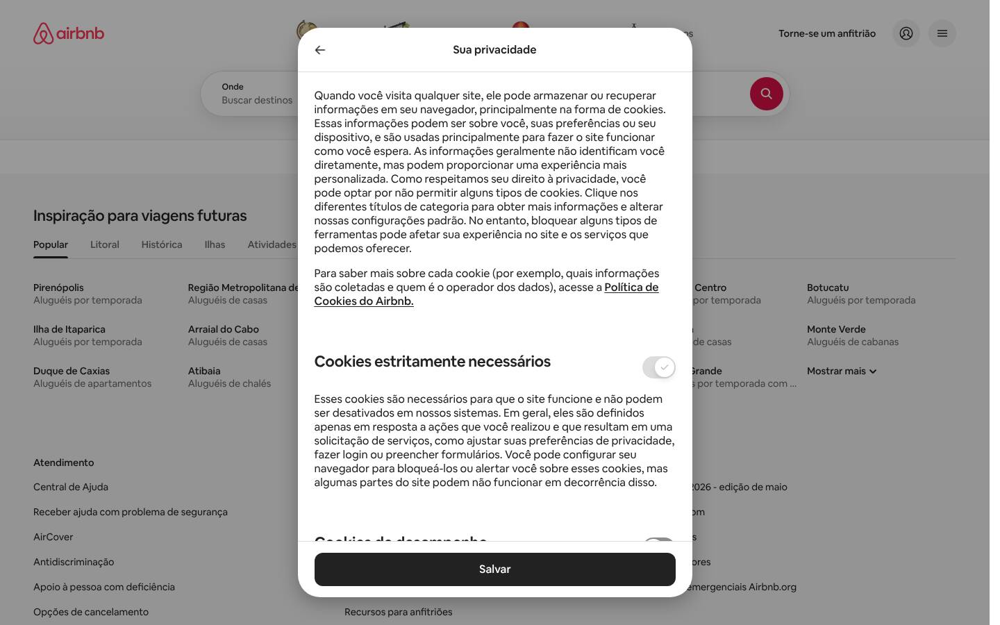
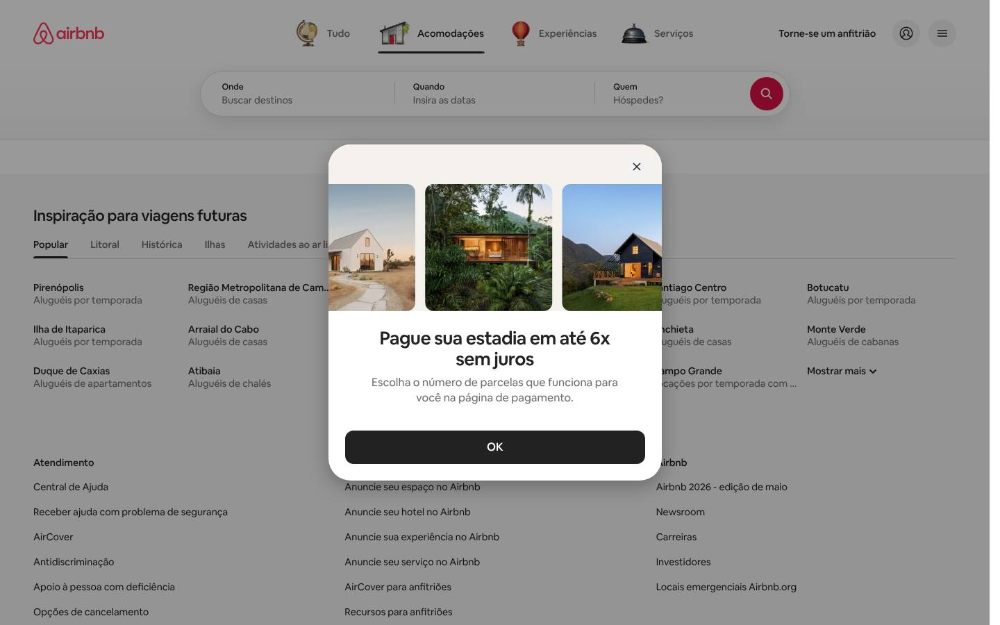

# uhome.com.br × Airbnb — comparativo completo do site (19/11/2026)

Atualização do documento "Airbnb × uhome.com.br — raio-X completo e plano", com a mesma estrutura. Agora a coluna Uhome vem do site real, testado no celular (360, 390 e 430 px) e no computador (1440 px), e não de suposições.

**Legenda:** ✅ pronto · 🟡 parcial · ❌ falta · ➖ não se aplica a venda de imóveis

---

## 1. Resumo executivo

- A Uhome já reproduz quase toda a experiência do Airbnb que faz sentido para compra de imóvel:
  - busca em pílula e busca em etapas no celular;
  - categorias com ícone 3D;
  - mapa com preço em pílula e busca ao mover;
  - filtros com histograma e contagem ao vivo;
  - gaveta do mapa com 3 alturas;
  - card com deslize de fotos;
  - página do imóvel com 1 foto grande + 4 menores e botão fixo de visita.
- **Maior distância que sobrou:** a velocidade real no celular. A busca leva 4,7 s nos visitantes reais; o bom é até 2,5 s. As correções desta semana baixaram o laboratório de 5,1 s para 3,8 s e ainda precisam ser publicadas.
- **Nova frente (seções 10 a 12): retorno ao site.** A jornada do site e o aviso ao corretor estão prontos. Faltam:
  - banner de consentimento;
  - pixel no navegador;
  - e-mail;
  - busca salva com alertas;
  - gatilhos de WhatsApp que levem o cliente de volta ao uhome.com.br.
- **Por decisão de negócio, ficam de fora:**
  - nota agregada do Google e número de corretores;
  - total de imóveis em vitrine;
  - datas e hóspedes;
  - qualquer item de aluguel.

## 2. Placar por área (0 a 10)

| Área | Airbnb | Uhome (antes) | Uhome (hoje) | Base da nota de hoje |
|---|---:|---:|---:|---|
| Busca (entrada) | 10 | 6 | 9 | Pílula Onde/Tipo/Valor; etapas em tela cheia no celular |
| Resultados + mapa | 10 | 7 | 9 | Lista + mapa fixo; gaveta com alça e 3 alturas |
| Pinos do mapa | 10 | 5 | 9 | Pílula branca com preço em todo zoom, que cresce ao passar no card |
| Filtros | 9 | 6 | 9 | Painel por cima, histograma, contagem ao vivo, "Mostrar N imóveis" |
| Card de imóvel | 9 | 8 | 9 | Selos, coração, pontinhos, deslize com o dedo (iPhone a confirmar) |
| Página do imóvel | 10 | 6 | 8 | Fotos 1+4, faixa de atalhos, agendamento, botão fixo |
| Conversão | 9 | 8 | 9 | Visita, WhatsApp, simulação, Lia, corretor |
| Mobile | 10 | 6 | 8 | Nenhuma página mais larga que a tela; abas do topo removidas |
| Movimento e efeitos | 10 | 6 | 8 | Tokens de movimento, toque com leve encolhida, respeito a "menos movimento" |
| Design system | 10 | 6 | 8 | Azul Uhome, Montserrat, botões de 12 px, toques de 44 px |
| Performance (laboratório) | 5 | 8 | 8 | Busca no celular lento: 3,8 s (era 5,1 s) |
| Performance real (visitantes) | 10 | 6 | 5 | Busca: LCP 4,7 s e INP 0,42 s no celular, antes de publicar |
| Acessibilidade | 9 | ? | 7 | 118 rótulos de leitura de tela, foco no teclado na galeria; sem auditoria completa |
| SEO técnico | 9 | 5 | 8 | 2.395 títulos "Casa_condominio" corrigidos; canônico https; links do mapa do site |
| Prova social | 10 | 4 | 6 | Depoimentos e selos; sem nota agregada (decisão de negócio) |

## 3. Desktop, ponta a ponta

| Item | Airbnb | Uhome hoje | Status |
|---|---|---|---|
| Header | Abas com ícone 3D, encolhe ao rolar | Logo + pílula de busca + botão de filtros; sem abas | ✅ |
| Busca segmentada | Onde / Quando / Quem com painéis | Onde / Tipo / Valor com painéis por campo | ✅ |
| Autocomplete | Negrito no trecho e tipo do resultado | Cidade, bairro e endereço; nome oficial da cidade sem diferenciar maiúsculas | 🟡 falta separar visualmente "Empreendimento" e "Código" |
| Home | Faixas de destinos e "Vistos recentemente" | Categorias 3D, faixas de imóveis, bairros, Por que Uhome, perguntas frequentes | ✅ |
| Lista + mapa | 2 colunas + mapa fixo | Grade + mapa fixo (a partir de 1024 px) | ✅ |
| Mini card do pino | Carrossel, coração, fechar | Foto, preço, coração, fechar, pontinha apontando o preço | ✅ |
| Filtros (modal) | Recomendados, tipo, preço com histograma, cômodos, comodidades | Tipo (vários), preço com histograma, quartos, banheiros, vagas, áreas, fase, comodidades, novidades | ✅ |
| Ordenar | Não tem | Mais recentes, menor e maior preço (valores simbólicos vão para o fim) | ✅ |
| Página do imóvel | Mosaico, tour, card fixo de reserva | Mosaico 1+4, galeria com zoom e teclado, faixa de atalhos, card lateral de visita | ✅ |
| Tour por cômodo | Fotos agrupadas por ambiente | Galeria única (o cadastro não informa o cômodo de cada foto) | 🟡 |
| Login | Um campo, telefone ou email | Email e Google; favoritos funcionam sem login | 🟡 falta entrar por telefone |

## 4. Mobile, ponta a ponta

| Item | Airbnb | Uhome hoje | Status |
|---|---|---|---|
| Topo limpo | Busca + pílulas | Busca + botão de filtros; abas removidas do código | ✅ (aparece depois de publicar) |
| Busca em etapas | Onde → Quando → Quem | Onde → Tipo → Valor, um cartão aberto por vez | ✅ |
| Filtro abre na hora | Sim | Painel por cima, sem trocar de página | ✅ |
| Chips de filtro ativo | Sim | Chips com "x" e "Limpar filtros" | ✅ |
| Mapa + gaveta | Alça e alturas | Alça, 3 alturas, "Mostrar mapa" | ✅ |
| Deslize de fotos no card | Foto segue o dedo | Foto segue o dedo e encaixa; toque abre o imóvel | 🟡 confirmar no iPhone real |
| Página do imóvel | Foto cheia + CTA fixo | Foto + botão fixo "Agendar visita" | ✅ |
| Barra inferior | Explorar / Favoritos / Viagens / Mensagens / Perfil | Explorar / Favoritos / Lia / Entrar | ✅ |
| Lia por cima dos painéis | — | Some quando um painel está aberto | ✅ |

## 5. Fundamentos técnicos

| Item | Airbnb | Uhome hoje | Status |
|---|---|---|---|
| Tipografia | Fonte própria | Montserrat própria, sem pedir fontes de fora | ✅ |
| Cores | Tokens | Tokens semânticos, azul Uhome | ✅ |
| Tokens de movimento | Molas | Curva padrão e encolhida ao toque | 🟡 sem molas |
| Primeira tela | Servidor | Primeira tela pronta servida pela borda (Home e Busca) | ✅ |
| Peso das fotos | Variações por tela | WebP de 480 px, 12 a 30 KB por card; 1ª foto adiantada | ✅ |
| Peso do app | Dividido por tela | Arquivo principal de ~630 KB | ❌ próximo passo |

## 6. Performance real (visitantes, p75, últimos 7 dias, antes de publicar)

| Página | LCP celular | INP celular | CLS |
|---|---|---|---|
| Busca | 4,7 s (lento) | 0,42 s (lento) | 0,05 (bom) |
| Imóvel | 3,2 s | — | bom |
| Home | 2,6 s | — | bom |

**Já feito, aguardando publicação:**
- imóveis pedidos no início do carregamento;
- 1ª foto adiantada;
- fotos extras só depois que a página fica pronta.

No laboratório, a busca baixou de 5,1 s para 3,8 s.

## 7. Diferenças que ainda restam (por prioridade)

| Prioridade | O que falta | Por quê |
|---|---|---|
| **P0** | Publicar e medir os visitantes reais | As melhorias só valem depois de publicadas |
| **P0** | Diminuir o arquivo principal (~630 KB) | É o que ainda segura a busca acima de 2,5 s |
| **P0** | Resposta ao toque (INP 0,42 s) | Achar o que trava ao tocar em filtro ou card |
| P1 | Confirmar o deslize de fotos no iPhone real | Testado só com toque simulado |
| P1 | Tipos no autocomplete (Bairro / Empreendimento / Código) | Igual ao Airbnb, mais claro |
| P1 | Auditoria de acessibilidade completa | Hoje há rótulos, mas sem auditoria formal |
| P2 | Entrar por telefone com WhatsApp | Mais simples que email |
| P2 | Tour por cômodo | Depende de o cadastro informar o ambiente da foto |
| P2 | Molas no movimento | Acabamento fino |

## 8. Fora de escopo por decisão da Uhome

- ➖ **Datas e hóspedes:** é venda, não estadia.
- ➖ **Nota agregada do Google, número de corretores e total de imóveis em vitrine:** regras do projeto.
- ➖ **Aluguel e preços de aluguel.**
- ➖ **Avaliações por imóvel:** substituídas por depoimentos de clientes.

## 9. O que não foi possível testar

- Gestos no iPhone real: deslizar fotos, arrastar a bolinha do preço, arrastar faixas.
- Envio de contato e visita: pela regra do projeto, não se envia lead de teste.
- O efeito das melhorias de velocidade nos visitantes reais, que só aparece após publicar.

---

## 10. Cookies, rastreamento, personalização e retorno ao site

> **Fontes desta seção (19/11/2026):**
> - **Airbnb:** navegado ao vivo nos três cenários de consentimento (antes de escolher, "Aceitar todos" e "Somente o necessário"), mais o teste de voltar ao site depois de buscar e abrir anúncios. Os tipos de notificação vêm da Central de Ajuda dele.
> - **Uhome:** código do CRM, que recebe a jornada do site e faz os disparos; pixels da Meta da conta Uhome (últimos 28 dias); DNS do domínio.
> - **Fora do alcance:** o código do site (Lovable). O que ele guarda no navegador do visitante está marcado como "confirmar no site".

### 10.1 Resumo

- **O Airbnb separa bem as duas coisas:** é rígido com cookies e consentimento e forte em chamar a pessoa de volta.
  - O banner tem 4 categorias.
  - Antes da escolha há só cookies essenciais. Com "Aceitar todos" entram 22 empresas de anúncio.
  - A memória (buscas, vistos, favoritos) fica **na conta**. Sem login, ele não lembrou a busca na volta.
  - Chama de volta por **e-mail, push no app, SMS e ligação**, com tipos de aviso que a pessoa liga e desliga. **Não usa WhatsApp.**
- **A Uhome tem uma peça que o Airbnb não tem:**
  - a **jornada do site chega na ficha do lead** e o **corretor é avisado quando o cliente volta ao site**;
  - o **motor de WhatsApp é robusto**, com tetos, supressão e pausa por qualidade.
- **O que falta é o circuito fechar:**
  - nenhum envio automático leva o cliente **de volta ao uhome.com.br**;
  - nada dispara pelo **comportamento no site**;
  - **não existe e-mail** (o provedor foi cancelado em 19/07/2026);
  - o **alerta de preço** pedido no site vira só uma anotação;
  - **não há banner de consentimento**;
  - **nenhum pixel no navegador** registra a navegação do site.

### 10.2 Placar das novas áreas (0 a 10)

| Área | Airbnb | Uhome hoje | Base da nota |
|---|---:|---:|---|
| Consentimento de cookies (LGPD) | 10 | 2 | Sem banner nem registro de consentimento no CRM; a Privacidade manda "gerenciar no navegador" (confirmar no site) |
| Rastreamento próprio da navegação | 9 | 8 | Jornada v1 com 14 tipos de evento, origem (UTM, gclid, fbclid), sem robôs, por sessão |
| Pixels de anúncio no navegador | 10 | 1 | Nenhum evento de navegador em 28 dias nos 21 pixels da conta Uhome |
| Conversões pelo servidor | — | 6 | ~1.300 eventos em 27 dias via CRM, qualidade 6,6/10; lead do site fica de fora |
| Memória sem login | 3 | ? | Airbnb não lembrou a busca; Uhome tem favoritos sem login (doc acima); buscas recentes a confirmar |
| Memória com conta / busca salva | 9 | 2 | Sem busca salva com alerta; o pedido "aviso de preço" vira anotação |
| E-mail de retorno | 10 | 0 | Nenhum envio a leads; Mailgun cancelado |
| WhatsApp de retorno | ➖ | 5 | Motor forte, mas sem gatilho por comportamento e sem link para o site |
| Push para o cliente | 10 | 0 | Push só para corretores |
| Aviso ao corretor quando o cliente volta | ➖ | 9 | Diferencial da Uhome |

### 10.3 Airbnb: cookies e rastreadores por cenário

| Cenário | Cookies | Domínios chamados (além do Airbnb) | Observação |
|---|---:|---|---|
| **Antes de escolher** | 7 | Google (googletagmanager, doubleclick) | Só essenciais e de segurança (`bev`, `datadome`, `_user_attributes`) e `_gcl_au` (vínculo de conversão do Google em modo restrito) |
| **"Somente o necessário"** | 9 | Google (o mesmo modo restrito) | Somam-se `_cci` e `_ccv` (registro da escolha). Nenhuma rede de anúncio |
| **"Aceitar todos"** | 42 | **22 domínios:** Meta, Google Ads e Analytics, Bing (`_uetsid`, `_uetvid`), Pinterest, Snapchat, The Trade Desk, Xandr, Rubicon, Outbrain, Podscribe | GA4 servido pelo próprio domínio (`FPID`, `FPLC`), cookies de experimento (`cdn_exp_*`) e sessão de telemetria própria (`jitney_*`) |

- **Banner**: 3 botões do mesmo tamanho ("Aceitar todos", "Somente o necessário", "Gerenciar preferências"). Recusar é tão fácil quanto aceitar.
- **Categorias**: estritamente necessários (não desliga), desempenho, funcionais e direcionamento, com link para a política de cookies.
- **Navegador**: no `localStorage` ficam só controles de interface e telemetria (impressões de avisos, aba atual, configuração do mapa). **Não há histórico de busca salvo no aparelho sem login.**
- **Bloqueio de robôs**: cookie `datadome` desde o primeiro acesso.

### 10.4 Airbnb: personalização e retorno

| Item | Airbnb | Observação |
|---|---|---|
| Voltar depois de buscar e abrir anúncios (sem login) | Mostra um aviso promocional uma única vez ("Pague sua estadia em até 6x sem juros") | Não mostrou "Buscas recentes" nem "Vistos recentemente". As sugestões do "Onde" seguem a localização do aparelho |
| Favoritos | Exigem login | O coração abre o login |
| Lembrar buscas e vistos | Na conta | Sincroniza entre app e site |
| Canais de retorno | E-mail, push no app, SMS, ligação | **Sem WhatsApp** |
| Tipos de aviso que a pessoa controla | "Lembretes", "Dicas de viagem e ofertas" (recomendações personalizadas), "Novidades do Airbnb" | Cada tipo pode ser ligado ou desligado por canal |
| Avisos obrigatórios | Reservas, atividade da conta, avisos legais, segurança e atendimento | Não podem ser desligados |
| Novidades de IA (outono 2026) | Busca por texto e voz, filtros sugeridos por IA, **comparação de favoritos com resumo por IA** | Ideia direta para a Uhome: comparar imóveis salvos |

### 10.5 Uhome: o que existe hoje

**Cookies e consentimento**
| Item | Status | Detalhe |
|---|---|---|
| Banner de consentimento | ❌ (confirmar no site) | Nenhum campo ou registro de consentimento no CRM. A Privacidade diz "gerencie os cookies no navegador" |
| Promessa da Privacidade | ❌ | Fala em "link de descadastro presente em nossos e-mails", mas **não existe e-mail para leads** |
| Leitura do `_fbp` e do `fbclid` | 🟡 | Os formulários do CRM guardam o `fbclid` por 7 dias e leem o cookie `_fbp` sem pedir consentimento (`src/lib/metaTracking.ts`) |

**Rastreamento da navegação**
| Item | Status | Detalhe |
|---|---|---|
| Jornada do site (contrato v1) | ✅ | 14 tipos de evento: página, busca, categoria, filtro, imóvel visto, favorito, dia escolhido, visita pedida, informações, Lia aberta, contato na Lia, WhatsApp, simulação, pedido de corretor |
| Origem da visita | ✅ | Primeira e última origem, com UTM, `gclid`, `gbraid`, `wbraid`, `fbclid`, referência e página de entrada |
| Limpeza | ✅ | Remove repetidos, ignora robôs, mostra 90 dias e atualiza a ficha a cada 30 s |
| Visitante anônimo ligado ao lead | ❌ | Só por e-mail ou telefone no momento do cadastro. Não existe identificador do aparelho; o `visitor_id` está só num plano |
| Guarda dos eventos | 🟡 | O corte de 90 dias acontece só na tela; o banco guarda tudo, sem expurgo |
| Canal antigo `site-events` | 🟡 | Ainda ativo, sem filtro de robô e sem limite de requisições |

**Pixels e conversões de anúncio**
| Item | Status | Detalhe |
|---|---|---|
| Pixel da Meta no navegador | ❌ | 21 pixels na conta; nenhum recebeu evento de navegador nos últimos 28 dias. Os pixels do site antigo pararam entre 2022 e 2023 |
| Conversões da Meta pelo servidor (CAPI) | 🟡 | Pixel "Uhome - Pixel CRM UhomeSales": LeadQualificado, VisitaMarcada, VisitaRealizada e Venda, qualidade 6,6/10. **Só aceita lead com ID de formulário da Meta ou clique do WhatsApp**: lead que chega pelo site fica de fora |
| Google Ads | 🟡 | Uma conversão "Visita realizada" por lead com `gclid`. Sem `gbraid` e `wbraid` (iPhone) e sem conversão aprimorada |
| GA4 pelo servidor | ❌ | Não existe |
| Públicos de remarketing por imóvel visto | ❌ | Impossível sem pixel no site. A sincronização de públicos está em modo de teste |

**Memória e personalização**
| Item | Status | Detalhe |
|---|---|---|
| Favoritos sem login | ✅ | Pelo documento acima. Vão do site para o CRM; não voltam |
| Buscas recentes e "vistos recentemente" no site | ? | Confirmar no código do site |
| Busca salva com alerta | ❌ | Não existe |
| Alerta de baixa de preço | ❌ | O pedido "aviso de preço" do site vira só a anotação "imóveis salvos". Também não existe histórico de preço |
| Novos imóveis compatíveis (Radar) | 🟡 | O CRM calcula os imóveis compatíveis e grava "não avisado", mas **ninguém envia**. Só roda quando o corretor clica |

**Retorno ao site**
| Canal | Status | Detalhe |
|---|---|---|
| E-mail | ❌ | Mailgun cancelado em 19/07/2026. Os modelos de e-mail de nutrição existem, mas não são usados. O único e-mail ao lead é o convite de agenda da visita |
| WhatsApp (campanhas) | 🟡 | Meta Cloud API, teto de 250/dia, lotes de 30, pausa por falhas e por qualidade, lista de supressão. **O link padrão aponta para uhomesales.com/casatua**, não para uhome.com.br |
| WhatsApp (reengajamento e Lia) | 🟡 | Janela 08–20h, cotas diárias, reserva única por envio, espera de 24 h após descarte, saída por palavra-chave. Voltado a **descartados**, não a quem navegou |
| WhatsApp "visita amanhã" | 🟡 | Configurado e pausado. A função de envio não está no repositório |
| Gatilho por comportamento no site | ❌ | Nada dispara para o cliente quando ele vê, favorita, busca ou abandona um agendamento |
| Links com origem | ❌ | O link que o corretor compartilha (`/c/{corretor}/imovel/...`) vai sem UTM. A volta pelo WhatsApp não é medida |
| Push para o cliente | ❌ | Só corretores |

**Aviso ao corretor**
| Item | Status | Detalhe |
|---|---|---|
| "Cliente voltou ao site" | ✅ | Lead com corretor: no máximo 1 aviso por hora, no sino e no push, respeitando silêncio e categorias |
| Descartado ou arquivado voltou | ✅ | Avisa o dono (ou os administradores), 1 por dia |
| "Radar de intenção" (cliente quente) | 🟡 | Pontua as últimas 24 h e avisa o dono, **mas sem trava de repetição e sem respeitar as preferências do corretor** |

### 10.6 Riscos para corrigir antes de crescer

| # | Risco | Por quê | Ação |
|---|---|---|---|
| 1 | Privacidade promete descadastro em e-mails que não existem e não há banner | Texto público desalinhado com a prática. Antes de ligar pixels, é preciso consentimento | Banner com 4 categorias, registro do consentimento e Privacidade revisada (validar com o jurídico) |
| 2 | Nenhum pixel no navegador | Sem público "viu imóvel" e sem otimização por comportamento | Pixel e tag do Google **só depois do consentimento**, com eventos padronizados |
| 3 | CAPI recusa lead do site | A Meta não aprende com quem vem do site | Aceitar lead com e-mail ou telefone e `fbp`/`fbc` capturados com consentimento |
| 4 | "Radar de intenção" sem trava e ignorando preferências | Pode encher o sino e o celular do corretor | Agrupar por lead e janela e usar a mesma rotina de notificação do "voltou ao site" |
| 5 | Novo pedido no site reabre quem tinha pedido para sair | Pode ser certo (novo consentimento), mas precisa ser explícito | Reabrir só o canal e o assunto do novo pedido, com registro |
| 6 | Eventos do site guardados sem prazo | A tela mostra 90 dias, mas o banco guarda tudo | Definir prazo de guarda e expurgo |
| 7 | Rastreador do CRM (`tracker.ts`) acumula eventos que nunca envia | Código morto que confunde | Remover ou ligar de verdade |

---

## 11. Plano: motor de retorno da Uhome (lembrar, avisar, trazer de volta)

> **Princípio:** lembrar sem obrigar login (melhor que o Airbnb), pedir o WhatsApp só quando o cliente ganha algo em troca (alerta, lista salva, visita) e **todo envio levar de volta ao uhome.com.br**, com origem medida.
> **Regras do projeto que continuam valendo:**
> - a jornada é só leitura, e o site grava só pelo servidor;
> - nada muda etapa ou corretor;
> - lead de teste fica fora;
> - os envios da Lia passam pelas reservas atuais.

### R0. Base legal e consentimento (1 semana)
- **Banner** no padrão do Airbnb: 3 botões de mesmo peso e 4 categorias (necessários, desempenho, funcionais, marketing), com Google Consent Mode v2.
- **Registro do consentimento** no lead: canal (WhatsApp, e-mail, push), data, texto aceito e origem. Saída por canal ("SAIR" no WhatsApp, link no e-mail).
- **Privacidade revisada** para bater com a prática.
- **Aceite**: com "Somente o necessário", nenhuma rede de anúncio é chamada (mesmo teste deste documento).

### R1. Identidade do aparelho (1 semana)
- **`visitor_id` próprio**, primário e com 13 meses, enviado em cada evento da jornada.
- Quando o visitante vira lead (formulário, Lia, agendamento, WhatsApp com telefone), **o histórico anônimo daquele aparelho entra na ficha**. O corretor passa a ver o que o cliente olhou **antes** de deixar o contato.
- **Aceite**: um lead novo chega com os imóveis vistos nos dias anteriores ao cadastro.

### R2. Memória no site, sem login (1 semana)
- **Buscas recentes** (últimas 5) no painel "Onde", e **"Continue de onde parou"** na home com a última busca e os filtros.
- **"Vistos recentemente"** na home e na página do imóvel.
- Favoritos sem login (já existe). **No 2º favorito**, convite: "Quer ser avisado se o preço baixar? Deixe seu WhatsApp".
- **Aceite**: fechar e abrir o site no mesmo aparelho mostra a última busca em 1 toque.

### R3. Busca salva e alertas (2 semanas)
- Botão **"Salvar esta busca"** nos resultados, com WhatsApp ou e-mail e consentimento.
- **Novo imóvel compatível**: ligar o Radar (que já calcula e grava "não avisado") a um envio **agrupado por dia**.
- **Baixa de preço** nos favoritos e nas buscas salvas: criar o **histórico de preço** na sincronização do catálogo, que hoje não existe.
- **Comparar favoritos** (até 3), inspirado na comparação do Airbnb.
- **Aceite**: imóvel novo que bate com a busca gera no máximo 1 aviso por dia, com link direto para o imóvel.

### R4. Canais (2 semanas, em paralelo)
| Canal | Uso | Regras |
|---|---|---|
| **WhatsApp** (principal) | Alertas de busca, baixa de preço, lembrete de visita, "ainda pensando?" | Modelos aprovados pela Meta. Reaproveitar as travas atuais (supressão, teto, pausa por qualidade) e **acrescentar horário 09–20h**. Link para `uhome.com.br/imovel/...?utm_source=whatsapp&utm_medium=alerta&utm_campaign={tipo}&send_id=...` |
| **E-mail** (resumo semanal) | "Novidades da sua busca", favoritos com preço novo | Contratar um provedor. **O SPF de hoje (`v=spf1 include:_spf.google.com ~all`) só autoriza o Google**: incluir o provedor, além de DKIM e DMARC. Descadastro em 1 clique |
| **Push no navegador** | Opcional, depois do 1º favorito | Só com permissão explícita |
| **Remarketing (Meta e Google)** | Quem viu imóvel e não pediu visita | Pixel e tag com consentimento. Eventos: `ViewContent` (imóvel), `Search`, `AddToWishlist` (favorito), `Schedule` (visita pedida), `Lead`. Google com conversão aprimorada, `gbraid` e `wbraid` |

### R5. Gatilhos por comportamento (1 semana, depois de R3 e R4)
| Gatilho no site | Ação | Canal | Limite |
|---|---|---|---|
| Favoritou e o preço baixou | "O imóvel que você salvou baixou para R$ X" | WhatsApp | 1 por imóvel |
| Busca salva recebeu imóvel novo | Resumo do dia | WhatsApp ou e-mail | 1 por dia |
| Escolheu dia de visita e não concluiu em 2 h | "Quer confirmar a visita de quinta às 15h?" | WhatsApp | 1 por imóvel |
| Viu o mesmo imóvel 3 vezes em 7 dias, sem contato | Aviso ao **corretor** (já existe), e ao cliente só com consentimento | Sino e WhatsApp | 1 por semana |
| Fez simulação de financiamento | Conteúdo de financiamento e convite para falar com o corretor | WhatsApp ou e-mail | 1 por mês |
| Sem visitar o site há 21 dias, com busca salva | "Novidades no Petrópolis desde sua última visita" | E-mail | 1 por mês |

**Limites gerais:**
- no máximo **2 mensagens automáticas por semana por cliente**, somando todos os canais;
- **pausa automática** quando o lead está em negociação com o corretor;
- mensagens **assinadas pelo corretor responsável**, que é avisado de cada envio.

### R6. Medição (contínuo)
- Todo link de envio leva UTM e `send_id`. A jornada do site registra a chegada e a ficha mostra **"voltou pelo alerta de baixa de preço"**.
- Indicadores:
  - taxa de retorno ao site em 7 e 30 dias;
  - visitas pedidas por alerta;
  - descadastro abaixo de 1%;
  - qualidade da conta do WhatsApp;
  - qualidade de correspondência na Meta (meta: 8 ou mais).
- Novas fontes de relatório **filtram lead de teste**, como manda a regra do projeto.

### O que não copiar do Airbnb
- **22 parceiros de anúncio**: para a Uhome bastam Meta e Google. É menos peso na página e menos risco de LGPD.
- **Exigir login para lembrar**: a Uhome lembra no aparelho e pede o WhatsApp só quando oferece algo em troca.

---

## 12. Limitações desta seção
- O código do site (Lovable) não estava acessível nesta sessão. O que o site grava no navegador (cookies próprios, buscas recentes, favoritos), se existe banner e quais tags estão instaladas precisa ser confirmado no repositório do site.
- O Airbnb foi testado sem login, a partir de um servidor nos EUA. Com conta, a personalização dele é maior. O cookie de proteção contra robôs (`datadome`) pode ter reduzido as recomendações.
- O pixel da Meta foi conferido só nos ativos da empresa Uhome. Se o site usa um pixel de outra conta, ele não aparece aqui.
